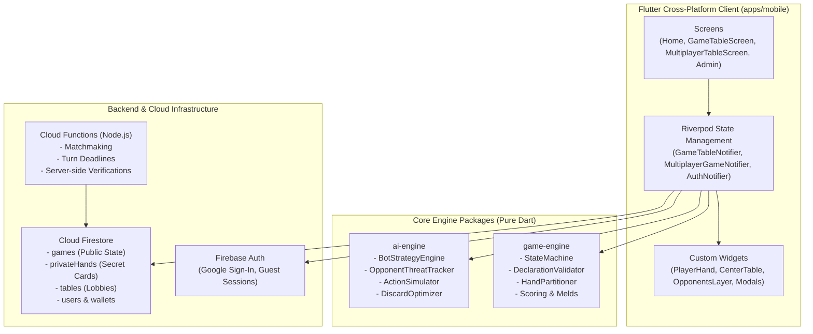
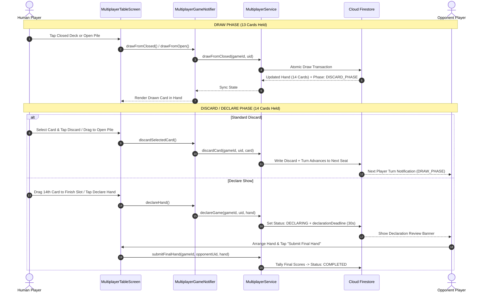
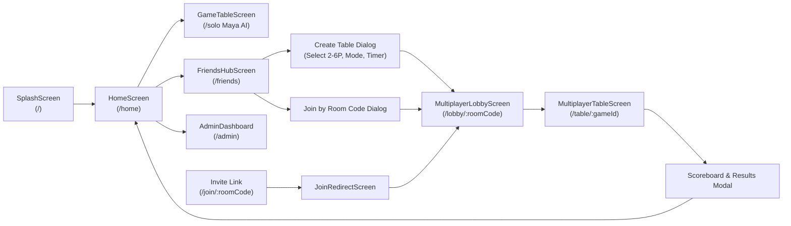

# MAYA AI RUMMY — COMPLETE CODEBASE KNOWLEDGE BASE & ARCHITECTURE GUIDE

> **Last Updated:** November 2026  
> **Repository:** `maya-ai-rummy`  
> **Purpose:** Authoritative reference manual for human engineers and AI coding assistants (Gemini, Claude, GPT). Documents every module, file, class, method, data flow, architecture diagram, and invariant across the entire project.

---

## Table of Contents

1. [Executive Summary & Tech Stack](#1-executive-summary--tech-stack)
2. [High-Level System Architecture](#2-high-level-system-architecture)
3. [Environment & Build Commands](#3-environment--build-commands)
4. [Monorepo Directory Skeleton & File Map](#4-monorepo-directory-skeleton--file-map)
5. [Core Package: `packages/game-engine`](#5-core-package-packagesgame-engine)
6. [Core Package: `packages/ai-engine`](#6-core-package-packagesai-engine)
7. [Client Architecture: `apps/mobile/lib`](#7-client-architecture-appsmobilelib)
8. [Turn Lifecycle & Sequence Flow](#8-turn-lifecycle--sequence-flow)
9. [Screen & Navigation Graph](#9-screen--navigation-graph)
10. [Single-Player (Maya Bot) Reference](#10-single-player-maya-bot-reference)
11. [Multiplayer Architecture & Realtime State Loop](#11-multiplayer-architecture--realtime-state-loop)
12. [Firebase Cloud Functions & Server Rules](#12-firebase-cloud-functions--server-rules)
13. [Firestore Data Schema & Collections](#13-firestore-data-schema--collections)
14. [State Management (Riverpod Providers Map)](#14-state-management-riverpod-providers-map)
15. [Complete Widget Catalog](#15-complete-widget-catalog)
16. [All Enums Reference](#16-all-enums-reference)
17. [Barrel Exports Reference](#17-barrel-exports-reference)
18. [Responsive Breakpoints & Viewport Calibration](#18-responsive-breakpoints--viewport-calibration)
19. [Known Bug Patterns & Architectural Invariants](#19-known-bug-patterns--architectural-invariants)
20. [User Accounts, Auth & Admin Dashboard Guide](#20-user-accounts-auth--admin-dashboard-guide)
21. [Developer & AI Quick-Lookup Index](#21-developer--ai-quick-lookup-index)
22. [AI Prompting & Future Agent Guide](#22-ai-prompting--future-agent-guide)

---

## 1. Executive Summary & Tech Stack

**Maya AI Rummy** is a high-performance, authentic Indian 13-Card Rummy platform featuring:
1. **Single-Player Mode**: Play against **Maya**, an intelligent AI bot powered by lookahead simulations, threat tracking, and adaptive heuristics.
2. **Multiplayer Mode (2 to 6 Players)**: Real-time room-code and public-lobby matchmaking with Firestore real-time synchronization, authoritative card dealing, turn timers, and spectator support.
3. **Cross-Platform Client**: Built with Flutter (Android, iOS, Web, Desktop), featuring responsive 3D perspective casino tables, custom card artwork, and royal aesthetics.
4. **Decoupled Architecture**: Pure Dart core game engine and AI engine, decoupled from Flutter UI and backend infrastructure.

### Technology Stack
| Layer | Technologies |
|---|---|
| **Mobile / Web / Desktop UI** | Flutter 3.x, Dart 3.x, Flutter Riverpod 2.x, GoRouter 13.x |
| **Fonts & Icons** | Google Fonts (Cinzel, Outfit, JetBrains Mono), Material Icons |
| **Core Game Engine** | Pure Dart package (`packages/game-engine`) |
| **Artificial Intelligence** | Pure Dart package (`packages/ai-engine`) |
| **Backend & Realtime** | Firebase Cloud Firestore, Firebase Authentication, Cloud Functions (Node.js 20) |
| **Visual Tooling** | Custom visual layout editor (`tools/layout_editor`) with Python HTTP bridge |
| **Build & Distribution** | Gradle (Kotlin DSL), Android ABI splits (ARM64-v8a, x86_64), Web (CanvasKit) |

**Production URLs**: `https://mayarummy.cwards.com` and `https://maya-rummy-vk.web.app`  
**Firebase Project**: `maya-rummy-vk`

---

## 2. High-Level System Architecture



---

## 3. Environment & Build Commands

| What | Command | Notes |
|---|---|---|
| **Run Client Tests** | `cd apps/mobile && flutter test` | Verifies all 45+ unit & widget tests |
| **Run Game-Engine Tests** | `cd packages/game-engine && dart test` | Verifies pure-Dart sequence, set, partition logic |
| **Run AI-Engine Tests** | `cd packages/ai-engine && dart test` | Verifies bot simulation, threat tracking, heuristics |
| **Flutter Analyze** | `cd apps/mobile && flutter analyze lib` | Checks for lint warnings and type mismatches |
| **Build Android Release APK** | `cd apps/mobile && flutter build apk --release --split-per-abi` | Outputs APKs to `build/app/outputs/flutter-apk/` |
| **Copy / Publish APK** | `cp apps/mobile/build/app/outputs/flutter-apk/app-arm64-v8a-release.apk releases/maya_ai_rummy.apk` | Root distribution artifact |
| **Install APK on Emulator / Device** | `adb install -r releases/maya_ai_rummy.apk` | Re-installs release build |
| **Launch App via ADB** | `adb shell am start -n com.maya.rummy.maya_ai_rummy_mobile/com.maya.rummy.maya_ai_rummy_mobile.MainActivity` | Opens app directly |
| **Build Web Release** | `cd apps/mobile && flutter build web --base-href /` | Builds Web CanvasKit distribution |
| **Deploy Firebase Hosting** | `$env:PATH = "C:\Program Files\nodejs;" + $env:PATH; cmd /c "npx firebase-tools deploy --only hosting --project maya-rummy-vk"` | Deploys web frontend |
| **Deploy Cloud Functions** | `$env:PATH = "C:\Program Files\nodejs;" + $env:PATH; cmd /c "npx firebase-tools deploy --only functions --project maya-rummy-vk"` | Deploys server logic |
| **Run Cloud Functions Tests** | `cd functions && node test/rules.test.js` | Runs JS server rules tests |

---

## 4. Monorepo Directory Skeleton & File Map

```
maya-ai-rummy/
├── apps/
│   └── mobile/                                # Flutter application (Android, iOS, Web, Desktop)
│       ├── lib/
│       │   ├── main.dart                      # Application root entry point
│       │   ├── core/                          # Cross-cutting foundational modules
│       │   │   ├── config/firebase_config.dart # Firebase initialization & configuration
│       │   │   ├── router/app_router.dart     # GoRouter configuration & route definitions
│       │   │   ├── theme/                     # App styling (AppColors, AppTheme, AppTextStyles)
│       │   │   └── utils/responsive.dart      # Device breakpoints (mobile, tablet, desktop)
│       │   └── features/                      # Domain features
│       │       ├── admin/                     # Backoffice & LiveOps management
│       │       │   ├── presentation/screens/  # AdminDashboardScreen
│       │       │   └── services/admin_service.dart
│       │       ├── auth/                      # Authentication (Google Sign-In & Guest)
│       │       │   ├── models/                # MultiplayerUser, AvatarCatalog
│       │       │   ├── providers/auth_provider.dart
│       │       │   └── services/auth_service.dart
│       │       ├── game/                      # Single-Player Mode (vs Maya AI Bot)
│       │       │   ├── models/                # CardGroup, GameSettings, RoundScore
│       │       │   ├── presentation/screens/  # GameTableScreen
│       │       │   ├── presentation/widgets/  # PlayerHand, CenterTable, ActionBar, Modals
│       │       │   └── providers/             # GameProvider (Maya bot lifecycle), GameUIProvider
│       │       ├── home/                      # Lobby, Hub, Profile, Rewards
│       │       │   ├── presentation/screens/  # HomeScreen, FriendsHubScreen, ProfileModal
│       │       │   ├── presentation/widgets/  # HeroSection, GameModesSelector, DailyChallengeCard
│       │       │   └── services/player_preferences_service.dart
│       │       ├── multiplayer/               # Realtime 2-6 Player Multiplayer
│       │       │   ├── models/table_models.dart # TableLobby, TablePlayer, MultiplayerGameState
│       │       │   ├── presentation/screens/  # MultiplayerTableScreen, MultiplayerLobbyScreen
│       │       │   ├── presentation/widgets/  # MultiplayerOpponentsLayer, MultiplayerActionBar
│       │       │   ├── providers/multiplayer_providers.dart # MultiplayerGameNotifier, LobbyNotifier
│       │       │   ├── services/multiplayer_service.dart   # Firestore sync & cloud orchestration
│       │       │   └── utils/game_log_exporter.dart
│       │       ├── progression/               # Leveling, XP, and career badges
│       │       ├── rewards/                   # Daily streaks, quest systems, coin grants
│       │       └── rules/                     # Interactive tutorial and rulebook screens
├── packages/
│   ├── game-engine/                           # Pure Dart: Rummy rules, models, hand partitioning
│   │   ├── lib/
│   │   │   ├── game_engine.dart               # Barrel export
│   │   │   └── src/
│   │   │       ├── models/                    # Card, Deck, Player, GameState, GameAction
│   │   │       ├── rules/                     # SequenceValidator, SetValidator, HandPartitioner
│   │   │       └── engine/                    # GameEngine, StateMachine
│   │   └── test/                              # 100+ comprehensive rules unit tests
│   └── ai-engine/                             # Pure Dart: Maya Bot AI decision making
│       ├── lib/
│       │   ├── ai_engine.dart                 # Barrel export
│       │   └── src/
│       │       ├── strategy/                  # BotStrategyEngine (heuristic discard, draw)
│       │       ├── analysis/                  # OpponentThreatTracker, HandAnalyzer
│       │       └── simulation/                # ActionSimulator, DiscardOptimizer
│       └── test/                              # AI strategy & simulation tests
├── functions/                                 # Firebase Cloud Functions (Node.js 20)
│   ├── index.js                               # Callable API endpoints (createTable, joinTable, etc.)
│   ├── engine/rummyRules.js                   # JavaScript port of Dart validation engine
│   └── test/rules.test.js                     # Server-side validation tests
├── tools/
│   └── layout_editor/                         # Visual Table Layout Editor & Python HTTP Bridge
├── releases/                                  # Compiled distribution APKs
├── KNOWLEDGE_BASE.md                          # Authoritative reference document
└── README.md                                  # Project overview and quick start
```

---

## 5. Core Package: `packages/game-engine`

**Path**: `packages/game-engine/lib/src/`  
**Dependencies**: Pure Dart (zero Flutter, zero Firebase).

### 5.1 Card Model (`models/card.dart`, 70 lines)
```dart
enum Suit { hearts, diamonds, clubs, spades }
enum Rank { ace, two, three, four, five, six, seven, eight, nine, ten, jack, queen, king }

class Card {
  final Suit? suit;          // null for printed jokers
  final Rank? rank;          // null for printed jokers
  final int deckIndex;       // 0 or 1 (2 standard 53-card decks)
  final bool isPrintedJoker; // true for printed jokers

  int toInt()                // deckIndex * 53 + suit.index * 13 + rank.index (or 52 for joker)
  static Card fromInt(int)   // Reverse integer mapping
  String get cardId          // Deterministic string (e.g. "AH-D0-0", "PJ-D1-52")
}
```

### 5.2 Hand Partitioner (`rules/hand_partitioner.dart`, 526 lines) — ★ Core Hand Logic
| Method | Lines | Purpose |
|---|---|---|
| `evaluateGroups(groups, openJoker)` | 52–161 | Evaluates user-arranged groups; returns `HandPartitionResult`. |
| `findValidPartition(hand, openJoker)` | 165–214 | Searches for any valid 13-card declaration meld. |
| `findBestPartition(hand, openJoker)` | 220–372 | ★ Optimizes hand grouping to minimize deadwood penalty. |
| `_findCandidateSequences(...)` | 447–472 | Generates sequence candidates (lengths 5→3, descending). |
| `_findCandidateSets(...)` | 474–491 | Generates set candidates (lengths 5→3, descending). |

### 5.3 Rule Validators
- **`sequence_validator.dart`** (229 lines):
  - Pure Sequence: $\ge 3$ consecutive cards of identical suit, no wild jokers used as substitutes (natural joker as itself allowed).
  - Impure Sequence: $\ge 3$ cards of identical suit with wild jokers or printed jokers substituting missing ranks.
  - No wrap-around allowed: `K-A-2` is invalid; `A-2-3` (Ace low) and `Q-K-A` (Ace high) are valid.
- **`set_validator.dart`** (108 lines):
  - 3 or 4 cards of identical rank across distinct suits.
  - Impure Set: Wild jokers or printed jokers substituting missing suits. Duplicate suits from deck 0 and deck 1 permitted in impure sets.
- **`declaration_validator.dart`** (55 lines):
  - Rummy Requirement: $\ge 1$ Pure Sequence, $\ge 2$ total Sequences (1 pure + 1 pure/impure), and all remaining cards grouped into valid sequences or sets.

### 5.4 Scoring (`rules/scoring.dart`, 111 lines)
- Face cards (`J`, `Q`, `K`, `A`): 10 points.
- Number cards (`2`–`10`): Face value points.
- Jokers (Printed or Wild): 0 points.
- Cap: Maximum deadwood penalty is capped at **80 points** (or custom table max penalty).
- Drop Penalties: First Drop = 20 pts, Middle Drop = 40 pts, Wrong Show = 80 pts.

---

## 6. Core Package: `packages/ai-engine`

**Path**: `packages/ai-engine/lib/src/`  
**Dependencies**: Pure Dart, depends on `game-engine`.

### 6.1 Architecture & Decision Engine
- **`BotStrategyEngine`** (`strategy/bot_strategy_engine.dart`):
  - Evaluates open pile top card vs closed deck draw expectation using Bayesian value estimation.
  - Selects discard card by evaluating hand potential after removing each candidate card.
  - Determines declaration readiness when deadwood reaches 0.
- **`OpponentThreatTracker`** (`analysis/opponent_threat_tracker.dart`):
  - Tracks cards picked by opponents from the open pile.
  - Infers opponent suit/rank meld intentions and prevents discarding "safe" cards that benefit opponents.
- **`ActionSimulator`** (`simulation/action_simulator.dart`):
  - Simulates 1-2 turn lookahead scenarios to choose highest expected utility play.

---

## 7. Client Architecture: `apps/mobile/lib`

### 7.1 Cross-Cutting Core
- **`app_router.dart`**: GoRouter routing definitions:
  - `/`: Splash & Home screen
  - `/solo`: Maya AI Single-Player table
  - `/friends`: Multiplayer Lobby Hub
  - `/lobby/:roomCode`: Waiting room for multiplayer match
  - `/join/:roomCode`: Direct invite link redirect handler
  - `/table/:gameId`: Live multiplayer 2-6 player table
  - `/admin`: LiveOps backoffice dashboard
- **`responsive.dart`**: Defines dynamic sizing and layout scaling:
  - Target Mobile Landscape: **1024.0 x 491.0** viewport.
  - Target Desktop: **1754.0 x 896.0** viewport.
- **`app_colors.dart`**: Luxury casino theme constants (Gold `#D4AF37`, Emerald Felt `#0D3322`, Velvet Crimson `#800020`, Midnight Navy `#0A0F1D`).

---

## 8. Turn Lifecycle & Sequence Flow



---

## 9. Screen & Navigation Graph



---

## 10. Single-Player (Maya Bot) Reference

**File**: `apps/mobile/lib/features/game/providers/game_provider.dart` (1,515 lines)  
This file serves as the **authoritative behavioral reference** for card interactions, animations, and game state mechanics:
- **Card Selection Pattern**: Exclusive single-select toggle (`selectCard(card)`).
- **Discard Validation**: `isDiscardPhase && isHumanTurn && selectedCard != null`.
- **Auto-Grouping**: Uses `HandPartitioner.findBestPartition(hand, wildJoker)`.
- **Closed Joker Reveal**: Triggers gold particle burst animation when player attains Pure Sequence (1st Life).
- **Fanned Open Pile**: Displays up to 5 cards with subtle offset stack ($x + 8	ext{px}, y + 6	ext{px}$).

---

## 11. Multiplayer Architecture & Realtime State Loop

**Service**: `apps/mobile/lib/features/multiplayer/services/multiplayer_service.dart` (1,597 lines)  
**Notifier**: `apps/mobile/lib/features/multiplayer/providers/multiplayer_providers.dart` (915 lines)

### Realtime State Loop
1. **Firestore Streams**:
   - `watchGame(gameId, myUid)` combines public `/games/{gameId}` with private `/games/{gameId}/privateHands/{myUid}`.
   - Updates `MultiplayerGameState` and invokes `_syncGroupsWithHand()`.
2. **Deterministic Hand Synchronization**:
   - Compares server cards with local card groups.
   - If local groups are empty or mismatched, runs `HandPartitioner.findBestPartition()` to prevent cards from splitting into single-card deadwood groups.
3. **Turn Timers**:
   - Standard Timers: 15s, 30s, 45s, 60s countdowns.
   - No-Limit Games (`turnTimerSeconds == 0`): Shows `⏱️ ∞` with inactive countdown.
   - Client Heartbeats: Recorded every 5 seconds to detect dropped connections.
   - Auto-Advance: If active player times out, client invokes `handleTurnTimeout()` to auto-draw and discard highest deadwood.

---

## 12. Firebase Cloud Functions & Server Rules

**File**: `functions/index.js` (765 lines)  
**Server Rules Engine**: `functions/engine/rummyRules.js` (352 lines)

| Callable Endpoint | Purpose |
|---|---|
| `createTable` | Creates table document with unique 8-character room code. |
| `joinTable` | Atomically assigns player to open seat in lobby. |
| `leaveTable` | Handles player exit, host reassignment, and abandonment. |
| `startGame` | Cryptographically shuffles 2 decks (106 cards), cuts wild joker, deals 13 cards to privateHands. |
| `drawFromClosed` | Draws top card from closed deck; triggers auto-reshuffle if deck exhausted. |
| `drawFromOpen` | Draws top card from discard pile; marks `cardDrawnFromOpenThisTurn`. |
| `discardCard` | Validates open-drawn card rule, checks turn ownership, advances seat index. |
| `declareGame` | Full server-side validation of declaration hand; wrong show assigns 80 penalty pts. |
| `updatePresence` | Heartbeat pulse tracking active player sockets. |

---

## 13. Firestore Data Schema & Collections

```
/tables/{tableId}
  ├── tableId: string
  ├── roomCode: string ("MAYA1234")
  ├── hostUid: string
  ├── maxPlayers: 2 | 3 | 4 | 5 | 6
  ├── status: "WAITING" | "STARTING" | "PLAYING" | "COMPLETED" | "ABANDONED"
  ├── gameMode: "Points Rummy" | "Pool 101" | "Pool 201" | "Best of 2 Deals"
  ├── turnTimerSeconds: 0 | 15 | 30 | 45 | 60
  └── players: [ TablePlayer array ]

/games/{gameId}
  ├── gameId: string
  ├── tableId: string
  ├── status: "IN_PROGRESS" | "DECLARING" | "COMPLETED"
  ├── phase: "DRAW_PHASE" | "DISCARD_PHASE"
  ├── currentTurnPlayerId: string (uid)
  ├── turnDeadline: ISO8601 string | null
  ├── openJoker: int (card ID)
  ├── openPile: [ int, int, ... ]
  ├── closedDeck: [ int, ... ]
  ├── closedDeckRemaining: int
  ├── declaringPlayerId: string | null
  ├── declarationDeadline: ISO8601 string | null
  ├── submittedPlayerUids: [ uid, ... ]
  ├── finalResults: [ MultiplayerFinalResult array ]
  └── actionLog: [ ActionLogEntry array ]

/games/{gameId}/privateHands/{uid}
  └── cards: [ int, int, ... ] (13 or 14 card integers)

/users/{uid}
  ├── uid: string
  ├── displayName: string
  ├── email: string
  ├── photoURL: string
  ├── coins: int (Virtual in-game balance)
  ├── role: "USER" | "ADMIN"
  └── stats: { gamesPlayed, wins, winRate }
```

---

## 14. State Management (Riverpod Providers Map)

| Provider | Type | File | State Type | Purpose |
|---|---|---|---|---|
| `multiplayerServiceProvider` | `Provider` | `multiplayer_providers.dart:11` | `MultiplayerService` | Singleton Firestore service interface |
| `multiplayerLobbyProvider` | `StateNotifierProvider` | `multiplayer_providers.dart:115` | `AsyncValue<TableLobby?>` | Live lobby subscription & seat state |
| `multiplayerGameProvider` | `StateNotifierProvider` | `multiplayer_providers.dart:912` | `MultiplayerGameTableState` | Active multiplayer gameplay state |
| `authProvider` | `StateNotifierProvider` | `auth_provider.dart:15` | `MultiplayerUser?` | Current authenticated user profile |
| `gameTableProvider` | `StateNotifierProvider` | `game_provider.dart:1512` | `GameTableState` | Single-player Maya AI state |
| `gameUIProvider` | `StateNotifierProvider` | `game_ui_provider.dart:30` | `GameUIState` | Animation and HUD overlay states |
| `homeProvider` | `StateNotifierProvider` | `home_provider.dart:20` | `HomeState` | Home lobby tabs and active modes |

---

## 15. Complete Widget Catalog

### 15.1 Gameplay Widgets (`features/game/presentation/widgets/`)
| Widget | File | Purpose |
|---|---|---|
| `CardWidget` | `card_widget.dart` | Face-up card with suit, rank, selection glow, and wild joker badge (377 lines). |
| `CardBackWidget` | `card_back_widget.dart` | Face-down card with royal pattern back. |
| `CardGroupWidget` | `card_group_widget.dart` | Meld group container with badge, fanning, and DragTarget support. |
| `PlayerHand` | `player_hand.dart` | Horizontal scroll-free card group arrangement container. |
| `CenterTable` | `center_table.dart` | Closed deck, tucked wild joker, and fanned open pile. |
| `ActionBar` | `action_bar.dart` | Discard, Group, Sort, AI Group, and Declare buttons. |
| `TurnIndicator` | `turn_indicator.dart` | Live status prompt banner ("Your Turn", "Draw 14th Card", etc.). |
| `ScoreCardModal` | `score_card_modal.dart` | Tournament scorecard with player scores and round history. |
| `DeclarationResultModal` | `declaration_result_modal.dart` | Diagnostics modal displaying declared hand breakdown. |

### 15.2 Multiplayer Widgets (`features/multiplayer/presentation/widgets/`)
| Widget | File | Purpose |
|---|---|---|
| `MultiplayerOpponentsLayer` | `multiplayer_opponents_layer.dart` | Opponent armchair seating (2 to 6 players) with calibrated coordinates and turn timers. |
| `MultiplayerActionBar` | `multiplayer_action_bar.dart` | Mobile/desktop responsive action buttons. |
| `MultiplayerPlayerHand` | `multiplayer_player_hand.dart` | Drag-and-drop card group layout for multiplayer matches. |

### 15.3 Home & Hub Widgets (`features/home/presentation/widgets/`)
| Widget | File | Purpose |
|---|---|---|
| `HeroSection` | `hero_section.dart` | Royal header with animated 5-card royal flush fan. |
| `GameModesSelector` | `game_modes_selector.dart` | Mode selection cards (Points Rummy, Pool 101, Pool 201, Best of 2 Deals). |
| `PlayWithMayaCTA` | `play_with_maya_cta.dart` | Primary call-to-action button for Single-Player Maya mode. |
| `DailyChallengeCard` | `daily_challenge_card.dart` | Daily missions and streak rewards tracker. |
| `ProfileModal` | `profile_modal.dart` | Player statistics, avatar picker, and career win rates. |

---

## 16. All Enums Reference

| Domain | Enum | File | Values |
|---|---|---|---|
| **Cards** | `Suit` | `game-engine/.../card.dart` | `hearts, diamonds, clubs, spades` |
| **Cards** | `Rank` | `game-engine/.../card.dart` | `ace, two, three, ..., queen, king` |
| **Melds** | `HandGroupType` | `game-engine/.../hand_partitioner.dart` | `pureSequence, impureSequence, validSet, invalid` |
| **Melds** | `SequenceType` | `game-engine/.../sequence_validator.dart` | `pure, impure` |
| **Game Phase** | `GamePhase` | `game-engine/.../game_state.dart` | `WAITING, DEALING, DRAW_PHASE, DISCARD_PHASE, DECLARATION, COMPLETE` |
| **Table Status**| `TableStatus` | `multiplayer/.../table_models.dart` | `WAITING, STARTING, PLAYING, COMPLETED, ABANDONED` |
| **Player Status**| `PlayerStatus` | `multiplayer/.../table_models.dart` | `ACTIVE, DECLARED, WRONG_SHOW, DROPPED, ELIMINATED` |
| **AI Level** | `AILevel` | `ai-engine/.../ai_config.dart` | `beginner, intermediate, advanced, expert` |
| **AI Threat** | `ThreatLevel` | `ai-engine/.../opponent_threat_tracker.dart` | `low, medium, high, critical` |

---

## 17. Barrel Exports Reference

### `packages/game-engine/lib/game_engine.dart`
```dart
export 'src/models/card.dart';
export 'src/models/deck.dart';
export 'src/models/player.dart';
export 'src/models/game_state.dart';
export 'src/models/game_action.dart';
export 'src/models/game_config.dart';
export 'src/models/game_result.dart';
export 'src/rules/declaration_validator.dart';
export 'src/rules/sequence_validator.dart';
export 'src/rules/set_validator.dart';
export 'src/rules/hand_partitioner.dart';
export 'src/rules/scoring.dart';
export 'src/rules/joker_utils.dart';
export 'src/engine/game_engine.dart';
export 'src/engine/state_machine.dart';
```

### `packages/ai-engine/lib/ai_engine.dart`
```dart
export 'src/models/bot_knowledge_state.dart';
export 'src/analysis/hand_analyzer.dart';
export 'src/analysis/opponent_threat_tracker.dart';
export 'src/simulation/action_simulator.dart';
export 'src/strategy/bot_strategy_engine.dart';
```

---

## 18. Responsive Breakpoints & Viewport Calibration

| Breakpoint | Width Range | Virtual Canvas Target | Scaling Container |
|---|---|---|---|
| **Mobile Landscape** | $< 900\text{px}$ | **1024.0 x 491.0** | `AspectRatio(aspectRatio: 1024/491, child: FittedBox(fit: BoxFit.contain))` |
| **Desktop / Tablet** | $\ge 900\text{px}$ | **1754.0 x 896.0** | `AspectRatio(aspectRatio: 1754/896, child: FittedBox(fit: BoxFit.contain))` |

### Seating Geometry on Mobile (1024x491)
- Table Top Rim sits at $Y \approx 228\text{px} - 235\text{px}$.
- To prevent avatars from overlapping onto the green felt table, opponent avatars in `multiplayer_opponents_layer.dart` must maintain:
  $$\text{avatarTop} + \text{avatarHeight} \le 225\text{px}$$
- **Calibrated Coordinates for 2P Mobile**:
  - `avatarTop`: $82.0\text{px}$
  - `avatarHeight`: $140.0\text{px}$
  - `ShaderMask` gradient stops: `[0.0, 0.70, 0.95]` for natural armchair blending.

---

## 19. Known Bug Patterns & Architectural Invariants

### 19.1 15-Card Draw Duplication Guard
- **Symptom**: Rapid drawing from closed deck caused hand count to balloon to 15 cards.
- **Invariant**: Before appending any drawn card, always verify:
  `!currentCards.contains(drawn) && currentCards.length < 14`

### 19.2 Initial Deal Hand Splitting Bug
- **Symptom**: When cards dealt on multiplayer tables, cards split into 13 individual 1-card groups.
- **Invariant**: In `_syncGroupsWithHand()`, if local groups are empty or mismatched, execute `HandPartitioner.findBestPartition(serverCards, wildJoker)` to automatically produce 3-4 structured melds.

### 19.3 Multi-Card Selection for Grouping
- **Symptom**: Tapping multiple cards failed to keep previous cards selected for manual grouping.
- **Invariant**: In `selectCard()`, toggle membership within `selectedCards` Set:
  `selectedCards.contains(card) ? selectedCards.remove(card) : selectedCards.add(card)`.

### 19.4 Closed Joker Lifecycle
- **Invariant**: When `jokerMode == 'CLOSED'`, `effectiveJokerForPlayer()` returns `null` until the player attains a Pure Sequence (1st Life). Once Life is formed, `openClosedJoker()` must be triggered, initiating the golden reveal particle animation.

### 19.5 No-Limit Turn Timer
- **Invariant**: When `turnTimerSeconds == 0`, `turnDeadline` is null. The timer HUD must display **`⏱️ ∞`** instead of an inactive 30s countdown.

---

## 20. User Accounts, Auth & Admin Dashboard Guide

### A. Account Types & Virtual Currency
- **Virtual Coins**: Strict virtual in-game economy. No real-money gambling, deposits, or withdrawals.
- **Account Registration**: Handled via Google Sign-In (`AuthService.signInWithGoogle()`).
- **Initial Grant**: 5,000 Free Virtual Coins upon profile creation (`createAccountWithProfile`).
- **Guest Access**: 0 coins, restricted to free AI tables (`signInAsGuest`).

### B. Admin Dashboard Access (`/admin`)
- **Route**: `https://mayarummy.cwards.com/#/admin`
- **Role Detection**:
  - Any email matching `vamsi`, `admin`, or `bhava` automatically assigned `role = 'ADMIN'`.
- **LiveOps Capabilities**:
  - `fetchKPIs()`: Aggregates real-time active tables, daily active users, and coin velocity.
  - `adminAdjustCoins()`: Credits or debits player coin balances with mandatory audit logs.
  - `adminSetAccountStatus()`: Suspends or restores player accounts.

---

## 21. Developer & AI Quick-Lookup Index

| I need to... | Inspect / Modify File |
|---|---|
| **Add / Edit Game Rules** (Melds, Sequences, Sets, Deadwood) | [`packages/game-engine/lib/src/rules/sequence_validator.dart`](file:///c:/Projects/maya-ai-rummy/packages/game-engine/lib/src/rules/sequence_validator.dart)<br>[`packages/game-engine/lib/src/rules/hand_partitioner.dart`](file:///c:/Projects/maya-ai-rummy/packages/game-engine/lib/src/rules/hand_partitioner.dart)<br>[`packages/game-engine/lib/src/rules/scoring.dart`](file:///c:/Projects/maya-ai-rummy/packages/game-engine/lib/src/rules/scoring.dart) |
| **Maya Bot Intelligence** (Discard heuristic, bluff detection) | [`packages/ai-engine/lib/src/strategy/bot_strategy_engine.dart`](file:///c:/Projects/maya-ai-rummy/packages/ai-engine/lib/src/strategy/bot_strategy_engine.dart)<br>[`packages/ai-engine/lib/src/analysis/opponent_threat_tracker.dart`](file:///c:/Projects/maya-ai-rummy/packages/ai-engine/lib/src/analysis/opponent_threat_tracker.dart) |
| **Maya Single-Player Game State** (Turn timers, hand actions) | [`apps/mobile/lib/features/game/providers/game_provider.dart`](file:///c:/Projects/maya-ai-rummy/apps/mobile/lib/features/game/providers/game_provider.dart) |
| **Multiplayer State & Synchronization** (Drawing, grouping, hand sync) | [`apps/mobile/lib/features/multiplayer/providers/multiplayer_providers.dart`](file:///c:/Projects/maya-ai-rummy/apps/mobile/lib/features/multiplayer/providers/multiplayer_providers.dart)<br>[`apps/mobile/lib/features/multiplayer/services/multiplayer_service.dart`](file:///c:/Projects/maya-ai-rummy/apps/mobile/lib/features/multiplayer/services/multiplayer_service.dart) |
| **Mobile & Desktop Table Layout** (Button positions, open pile) | [`apps/mobile/lib/features/multiplayer/presentation/screens/multiplayer_table_screen.dart`](file:///c:/Projects/maya-ai-rummy/apps/mobile/lib/features/multiplayer/presentation/screens/multiplayer_table_screen.dart)<br>[`apps/mobile/lib/features/game/presentation/screens/game_table_screen.dart`](file:///c:/Projects/maya-ai-rummy/apps/mobile/lib/features/game/presentation/screens/game_table_screen.dart) |
| **Opponent Seating & Avatars** (Coordinates, seat offsets, avatar sizing) | [`apps/mobile/lib/features/multiplayer/presentation/widgets/multiplayer_opponents_layer.dart`](file:///c:/Projects/maya-ai-rummy/apps/mobile/lib/features/multiplayer/presentation/widgets/multiplayer_opponents_layer.dart) |
| **Authentication & User Profiles** (Google Sign-In, Guest, Avatar catalog) | [`apps/mobile/lib/features/auth/services/auth_service.dart`](file:///c:/Projects/maya-ai-rummy/apps/mobile/lib/features/auth/services/auth_service.dart)<br>[`apps/mobile/lib/features/auth/models/avatar_catalog.dart`](file:///c:/Projects/maya-ai-rummy/apps/mobile/lib/features/auth/models/avatar_catalog.dart) |
| **Backend Matchmaking & Server Functions** (Room code generation, Cloud functions) | [`functions/index.js`](file:///c:/Projects/maya-ai-rummy/functions/index.js) |
| **Run All Tests** | `cd apps/mobile && flutter test` |

---

## 22. AI Prompting & Future Agent Guide

When instructing future AI coding assistants on this repository, provide clear module context using these templates:

### Prompt Template 1: Game Rules & Hand Partitioning
> "Inspect `packages/game-engine/lib/src/rules/hand_partitioner.dart` and `declaration_validator.dart`. Ensure pure sequence requirements adhere strictly to 13-card Indian Rummy standards (at least 1 pure sequence without jokers, at least 2 sequences total). Verify using `cd packages/game-engine && dart test`."

### Prompt Template 2: Multiplayer State & Networking
> "Inspect `apps/mobile/lib/features/multiplayer/providers/multiplayer_providers.dart` and `multiplayer_service.dart`. When modifying card movement or turn actions, verify against the invariants documented in Section 19 of `KNOWLEDGE_BASE.md`. Run `cd apps/mobile && flutter test`."

---
*Last updated: November 2026. Maintained for AI Agents and Human Developers.*
