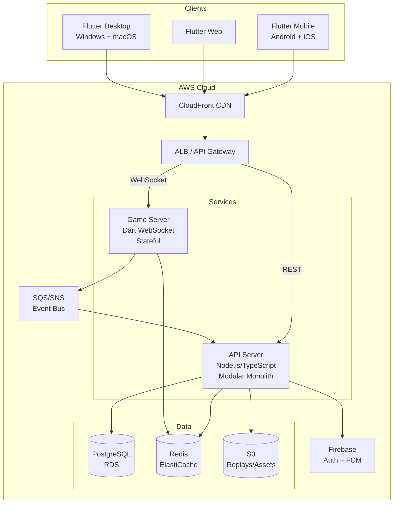

# 🃏 Indian 13-Card Rummy — Master Technical & Product Specification

> **Version:** 1.0  
> **Date:** September 22, 2026  
> **Status:** Ready for Development  
> **Total Specification:** ~144 KB across 6 detailed documents

---

## Executive Summary

This master specification defines the complete technical architecture for a **cross-platform Indian 13-Card Rummy gaming platform** — from product vision through implementation, designed to be launched by a small team in 6 months and scaled to 10M+ users without rewriting the core engine.

### Key Technology Decisions

| Area | Decision | Rationale |
|------|----------|-----------|
| **Client Framework** | Flutter (Dart) | Best code reuse + game animation performance across 5 platforms |
| **Game Engine** | Pure Dart library | Shared between client and server — zero logic duplication |
| **Backend API** | Node.js / TypeScript (NestJS) | Rich ecosystem, fast development, strong typing |
| **Game Server** | Dart Standalone (WebSocket) | Shares game engine code with client |
| **Database** | PostgreSQL + Redis | ACID for ledger, speed for real-time state |
| **Cloud** | AWS (Mumbai region) | Full-service Indian presence, cost-effective |
| **Architecture** | Modular Monolith + separate Game Server | Fast MVP, clean service boundaries for future extraction |
| **Auth** | Firebase Auth + custom JWT | Handles Google/Apple/Phone with minimal effort |
| **Ads** | Google AdMob with mediation | Best fill rates in India |
| **Analytics** | Mixpanel + custom event pipeline | Product analytics + raw data ownership |
| **AI (V1)** | Deterministic heuristic + probability | No ML dependencies, ships immediately |
| **CI/CD** | GitHub Actions | Industry standard, excellent Flutter/Node support |

### Architecture at a Glance

---

## Specification Documents

The complete specification is organized into 6 detailed parts. Each is a standalone document that covers a major system area.

### [Part 1: Product Vision, Technology Stack & Core Architecture](file:///C:/Users/Bhava/.gemini/antigravity/brain/7484f3a2-33ff-441c-9c34-46f1fc0288f9/part1_core_architecture.md)
**~17 KB · 310 lines**

Covers:
- Product vision and success metrics
- Complete technology stack comparison tables (Flutter vs React Native vs Unity vs Godot)
- Architecture philosophy: Modular Monolith vs Microservices
- High-level system architecture diagram
- Microservices evolution plan (V1 → V2 → V3)
- Complete repository structure with directory tree
- CI/CD pipeline design with GitHub Actions
- Docker and Terraform configuration
- Environment management (DEV / STAGING / PRODUCTION)

---

### [Part 2: Game Engine, State Machine, Multiplayer & Replay](file:///C:/Users/Bhava/.gemini/antigravity/brain/7484f3a2-33ff-441c-9c34-46f1fc0288f9/part2_game_engine.md)
**~19 KB · 490 lines**

Covers:
- Complete 13-card Indian Rummy rules specification
- Game engine as pure Dart library (zero external dependencies)
- Card, Deck, and Game models with Dart code
- Game state machine with mermaid diagram
- All game actions and commands with type definitions
- Server-side validation for every action
- Declaration validation algorithm (complete implementation)
- Scoring system with edge cases
- Deterministic replay data format and storage
- Multiplayer authoritative server architecture
- WebSocket protocol specification
- Disconnect/timeout/reconnection handling
- Game modes as plugin architecture
- Spectator system with privacy controls

---

### [Part 3: AI Opponent System](file:///C:/Users/Bhava/.gemini/antigravity/brain/7484f3a2-33ff-441c-9c34-46f1fc0288f9/part3_ai_system.md)
**~26 KB · 701 lines**

Covers:
- AI architecture pipeline (Observation → Evaluation → Scoring → Execution)
- AI as pure Dart library with interfaces
- Hand evaluation algorithm (optimal grouping with recursive partitioning)
- Card tracking and probability calculation
- Opponent modeling and inference
- 4 concrete strategies: Sequence-First, Set-Priority, Defensive, Aggressive
- Strategy switching logic with Dart implementation
- Draw decision algorithm with risk assessment
- Discard decision algorithm with opponent awareness
- 4 AI difficulty levels with configuration (Beginner → Expert)
- Monte Carlo simulation for Advanced/Expert AI
- Determinized Monte Carlo Tree Search
- AI training pipeline roadmap (V1 heuristic → V5 reinforcement learning)
- AI performance telemetry and target win rates

---

### [Part 4: Backend Services, Database, APIs & Infrastructure](file:///C:/Users/Bhava/.gemini/antigravity/brain/7484f3a2-33ff-441c-9c34-46f1fc0288f9/part4_backend_infrastructure.md)
**~23 KB · 585 lines**

Covers:
- Backend architecture overview (API server + Game server)
- Complete API endpoints for all 10 modules with request/response schemas
- Full PostgreSQL database schema (20+ tables with indexes)
- Double-entry wallet ledger with audit trail
- Redis architecture (sessions, matchmaking, leaderboards, game state)
- Event-driven architecture with full event catalog (20+ events)
- WebSocket protocol type definitions (client ↔ server)
- AWS V1/V2/V3 architecture with mermaid diagrams
- AWS cost estimates for 10K → 10M MAU
- Admin panel modules and RBAC roles
- Notification system (FCM + APNs)

---

### [Part 5: Frontend, Security, Anti-Cheat & Operations](file:///C:/Users/Bhava/.gemini/antigravity/brain/7484f3a2-33ff-441c-9c34-46f1fc0288f9/part5_frontend_security_ops.md)
**~26 KB · 489 lines**

Covers:
- Flutter application architecture (Riverpod, GoRouter, Dio)
- Complete screen map (25+ screens with hierarchy)
- Game table UI design and card interaction model
- Animation system (15+ animations with implementation approach)
- Card themes and customization system
- Responsive layout (mobile → tablet → desktop breakpoints)
- Accessibility (screen readers, color-blind, large text)
- Internationalization (8 Indian languages)
- Sound design (15+ sound effects with triggers)
- Security architecture (transport, auth, API, game, data, infrastructure)
- Security threat model (12 threats with mitigations)
- Anti-cheat system (server detection, collusion, risk engine)
- Observability and monitoring (logging, metrics, tracing, alerting)
- Analytics architecture and KPI dashboards
- Testing strategy (unit, integration, simulation, load, security, E2E)
- Customer support tools
- Feature flags system
- Future real-money provider interfaces

---

### [Part 6: Development Roadmap, Costs, Team & Evolution](file:///C:/Users/Bhava/.gemini/antigravity/brain/7484f3a2-33ff-441c-9c34-46f1fc0288f9/part6_roadmap_costs.md)
**~35 KB · 533 lines**

Covers:
- MVP definition (includes vs excludes)
- **Week-by-week implementation plan (24 weeks / 6 months)**
  - Week 1-2: Foundation & Game Engine
  - Week 3-4: Game Engine completion + Auth
  - Week 5-6: Game Server + WebSocket
  - Week 7-8: AI + Matchmaking
  - Week 9-11: Flutter Game Table UI
  - Week 12-13: Home Screen + Profile
  - Week 14-15: Virtual Economy + Rewards
  - Week 16-17: Social Features
  - Week 18-19: Leaderboards + Notifications
  - Week 20-21: Admin Panel + Anti-Cheat
  - Week 22-23: Polish + Integration Testing
  - Week 24: Beta Launch
- Post-MVP roadmap (V1.1, V1.2, V2.0)
- **3-year technical evolution roadmap** (Year 1 → Year 2 → Year 3)
- Development team requirements (ideal 10-person vs minimum 3-4 with AI tools)
- AI-coding development strategy and workflow
- **Cost estimates**: MVP development (\$70K-\$137K), infrastructure by scale
- **Revenue projections**: Ad-based model at different MAU tiers
- Virtual economy simulation model (sources, sinks, anti-inflation)
- Player retention design (D1 through D30 mechanisms)
- Launch strategy (alpha → closed beta → open beta → soft launch → full launch)

---

## Quick Reference: What to Read First

| If you are... | Start with |
|---------------|------------|
| **Product Manager** | Part 1 (Vision) → Part 6 (Roadmap, MVP, Costs) |
| **Backend Engineer** | Part 4 (APIs, Database) → Part 2 (Game Engine) |
| **Frontend/Flutter Developer** | Part 5 (Flutter Architecture) → Part 2 (Game Engine) |
| **Game/AI Engineer** | Part 3 (AI System) → Part 2 (Game Engine) |
| **DevOps Engineer** | Part 1 (Architecture, CI/CD) → Part 4 (AWS, Infrastructure) |
| **Security Engineer** | Part 5 (Security, Anti-Cheat) → Part 4 (Database, Events) |
| **Designer** | Part 5 (UI, Animations, Accessibility) → Part 6 (MVP Scope) |

---

## Next Steps

1. **Review this specification** — All 6 parts are ready for team review
2. **Approve technology stack** — Flutter + Dart game server + Node.js API
3. **Set up repository** — Follow the structure in Part 1
4. **Begin Week 1** — Game engine foundation as defined in Part 6
5. **Start development** — Use the `/goal` command to begin implementing any specific part

> [!TIP]
> This specification is designed to be a **living document**. Update the relevant part as architectural decisions evolve during development.
