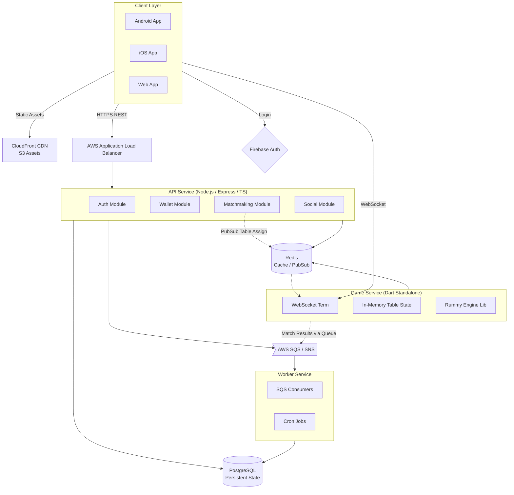

# PART 1: PRODUCT VISION, TECHNOLOGY STACK & CORE ARCHITECTURE

## 1. Product Vision & Executive Summary

The platform is a highly scalable, cross-platform Indian 13-Card Rummy gaming application designed specifically for the Indian market. The vision is to deliver a seamless, high-performance card gaming experience that bridges mobile, desktop, and web platforms with a single unified codebase.

### Core Experience Flow
- **Download & Onboarding**: Lightweight app size. Frictionless onboarding via Truecaller/Phone/Google login (Firebase Auth).
- **Play**: Instant matchmaking or private tables. Low-latency card mechanics with offline resilience and graceful reconnect handling.
- **Social**: Friend lists, gifting, leaderboards, and chat, enhancing community building.
- **Retain**: Daily rewards, continuous progression loops, tournaments, and dynamic difficulty AI for practice modes.

### Target Audience
Indian mobile gamers across Tier 1, Tier 2, and Tier 3 cities. The platform assumes diverse network conditions, requiring robust offline-to-online state reconciliation and minimal data consumption.

### Business Model
- **Free-to-Play**: Core gameplay is entirely free.
- **Ads**: Google AdMob integration (banner, interstitial, rewarded video).
- **Virtual Economy**: In-app purchases for chips, avatars, table themes, and VIP subscriptions.

### Key Differentiators
1. **Shared Game Engine**: Core rummy logic (deck shuffling, meld validation, score calculation) is written in pure Dart and shared between the Flutter client and Dart game server, eliminating logic duplication and drift.
2. **Cross-Platform Parity**: 100% feature and UI parity across Android, iOS, Web, and Desktop.
3. **Smart Reconnects**: Advanced state synchronization allowing players to drop and reconnect seamlessly without interrupting the table.

### Success Metrics
- **Acquisition**: CPA < $0.50
- **Retention**: D1 > 40%, D7 > 15%, D30 > 5%
- **Engagement**: > 45 minutes average session length
- **Monetization**: ARPDAU > $0.05

---

## 2. Technology Stack Decisions

### Client / Frontend Framework

| Criteria | Recommended | Alternative | Why |
| :--- | :--- | :--- | :--- |
| **Framework** | **Flutter (Dart)** | React Native, Unity, Godot | **Decision**: Flutter provides the best balance of UI performance, code reuse, and development velocity for a card game. <br><br>**Justification**: Card games rely heavily on custom UI and 2D animations rather than a 3D physics engine. Flutter's `CustomPainter` and implicit animation system are perfect for card movements, flips, and dealing. Unity is overkill, resulting in large app sizes and excessive battery drain. React Native struggles with complex 60fps animations due to the JS bridge overhead. Godot has a smaller ecosystem for standard app UI elements (login, settings, store). Crucially, Dart allows us to share the exact same game rules engine with our backend game server. |

### Backend APIs & Game Server

| Criteria | Recommended | Alternative | Why |
| :--- | :--- | :--- | :--- |
| **API Server** | **TypeScript (Node.js)** | Go, Java/Kotlin | **Decision**: Node.js/TypeScript is ideal for our modular monolith REST/GraphQL API. The ecosystem for tooling, DB ORMs (Prisma), and hiring in India is massive. Go offers better raw performance but slower time-to-market. |
| **Game Server** | **Dart (Standalone)** | Node.js, Go | **Decision**: The stateful game server will be written in pure Dart using `dart:io` and `shelf_web_socket`. This allows us to compile our `packages/game-engine` and use it on the server to validate moves, preventing cheating, without rewriting complex Rummy logic in two languages. |

### Database & Storage

| Criteria | Recommended | Alternative | Why |
| :--- | :--- | :--- | :--- |
| **Primary DB** | **PostgreSQL** | MySQL, MongoDB | **Decision**: Relational integrity is non-negotiable for virtual wallets, transactions, and user progression. PostgreSQL handles JSONB well for flexible game metadata while providing ACID compliance. |
| **Cache/Real-time** | **Redis** | Memcached | **Decision**: Used for matchmaking queues, session management, leaderboard caching, and pub/sub between game server instances. |
| **Storage** | **AWS S3** | GCS, Azure Blob | **Decision**: Used for storing avatars, dynamic game assets, and downloadable patches. |

### Infrastructure & Operations

| Criteria | Recommended | Alternative | Why |
| :--- | :--- | :--- | :--- |
| **Cloud Provider** | **AWS** | GCP, Azure | **Decision**: AWS offers the most mature ecosystem. We will stick to managed services (RDS, ElastiCache, ECS/EKS) to allow potential portability, avoiding extreme lock-in. |
| **Real-time Comms** | **WebSockets** | gRPC, Server-Sent Events | **Decision**: WebSockets via `dart:io` natively supports full-duplex communication necessary for real-time multiplayer card games. |
| **Message Queue** | **AWS SQS/SNS** | Kafka, RabbitMQ | **Decision**: For V1, SQS/SNS handles async tasks (rewards, analytics aggregation, emails) with zero operational overhead. Kafka is planned for scaling to millions of DAU. |
| **Authentication** | **Firebase Auth + Custom JWT** | Auth0, AWS Cognito | **Decision**: Firebase Auth provides seamless mobile OTP/Google/Apple sign-in. Once authenticated via Firebase, the backend issues a custom JWT for API/WebSocket authorization to avoid constant external API calls. |
| **Analytics** | **Mixpanel + Custom Event Pipeline** | Firebase Analytics | **Decision**: Mixpanel provides superior funnel and retention analysis out of the box. A custom pipeline (events dropped to SQS -> S3) ensures we own our raw data from day 1. |
| **CI/CD** | **GitHub Actions** | GitLab CI, Jenkins | **Decision**: Deeply integrated with the repo, fast setup, and great marketplace actions for Flutter and Node.js. |
| **IaC** | **Terraform** | AWS CDK, CloudFormation | **Decision**: Terraform provides a cloud-agnostic configuration language and excellent state management. |
| **Monitoring** | **CloudWatch + Sentry + Grafana** | Datadog | **Decision**: CloudWatch for logs/metrics, Sentry for client/backend crash reporting, and Grafana for business/technical dashboards. Avoids massive Datadog bills for V1. |

---

## 3. Architecture Philosophy

### The Modular Monolith Approach (V1)
For V1, the API backend will be structured as a **Modular Monolith** rather than a distributed microservices architecture. 
- **Faster Development**: Single repository, single deployment pipeline, easy local setup.
- **Simpler Debugging**: Stack traces span the whole request, no complex distributed tracing required initially.
- **Module Boundaries**: The code will be strictly divided into domains (Auth, Wallet, Matchmaking). Modules communicate via in-process interfaces or local event buses. They do *not* share database tables directly.

### The Game Server Exception
The **Game Server** is the ONE exception. It is deployed as a completely separate service from Day 1 because:
- **Stateful vs Stateless**: API servers are stateless and scale horizontally based on CPU/HTTP traffic. Game servers are stateful, holding active WebSocket connections and in-memory game state.
- **Language**: The Game Server is built in Dart to leverage the shared Rummy engine, while the API is TypeScript.
- **Deployment**: Game servers require specialized deployment strategies (draining connections, sticky sessions) compared to standard REST APIs.

### Event-Driven Internal Communication
While running as a monolith, modules will emit domain events (e.g., `GameFinished`, `UserLevelUp`). 
- **Synchronous**: REST API calls from client.
- **Asynchronous**: Events pushed to an internal Event Bus (backed by SQS for persistence), picked up by Worker instances for processing (e.g., updating leaderboards, granting achievements) so API response times remain fast.

---

## 4. High-Level Architecture Diagram



---

## 5. Microservices Evolution Plan

We define strict boundaries in V1 to ensure seamless extraction into microservices for V2.

### V1 Modular Monolith Modules
- **Auth Module**: Validates Firebase tokens, manages JWTs, handles session revocation.
- **User/Profile Module**: User settings, avatars, basic metadata.
- **Game Module**: Historical game records, replay metadata, generic game configs.
- **Matchmaking Module**: Puts players in queues, pairs them, and allocates them to a Game Server node.
- **Wallet Module**: Manages virtual currency balances, handles transaction ledgers with strict ACID guarantees.
- **Reward Module**: Daily bonuses, quest tracking.
- **Social Module**: Friends lists, messaging (polling or lightweight WS).
- **Leaderboard Module**: Tracks ELO/Scores and populates Redis sorted sets.

### V2 Extraction Triggers & Plan
When scale dictates, we break out modules in the following order:

1. **Matchmaking Service**
   - **Trigger**: > 10,000 concurrent users. 
   - **Plan**: Move to a dedicated Go or Rust service backed by Redis for hyper-fast queue processing.
2. **Wallet & Ledger Service**
   - **Trigger**: Introduction of complex economy, multiple currencies, or real-money (if legalized/pivoted).
   - **Plan**: Isolate entirely to ensure strict compliance, separate database scaling, and high-security VPC isolation.
3. **Analytics & Data Pipeline**
   - **Trigger**: > 1 Million events per day.
   - **Plan**: Move from SQS to Kafka, implement ClickHouse for real-time analytics aggregation, freeing up PostgreSQL.
4. **Notification Service**
   - **Trigger**: Heavy load from push notifications / in-game broadcasts.
   - **Plan**: Extract to a standalone Go service.

---

## 6. Repository Structure

We utilize a Monorepo strategy (using Turborepo or Melos for Dart) to keep cross-cutting concerns (like the Rummy engine and shared types) perfectly synchronized.

```text
rummy-platform/
├── apps/
│   ├── mobile/                  # Main Flutter application
│   │   ├── lib/
│   │   │   ├── features/        # (e.g., game, lobby, profile)
│   │   │   ├── core/            # (network, theme, utils)
│   │   │   └── main.dart
│   │   ├── pubspec.yaml
│   │   └── ...
│   └── admin/                   # Next.js admin panel for customer support & live ops
│       ├── src/
│       ├── package.json
│       └── ...
├── server/
│   ├── api/                     # Node.js/TypeScript API server
│   │   ├── src/
│   │   │   ├── modules/         # (auth, wallet, matchmaking)
│   │   │   ├── core/            # (db connections, middlewares)
│   │   │   └── app.ts
│   │   ├── prisma/              # Database schema & migrations
│   │   └── package.json
│   ├── game-server/             # Dart standalone Game Server
│   │   ├── bin/
│   │   │   └── server.dart
│   │   ├── lib/
│   │   │   ├── handlers/        # WebSocket message handlers
│   │   │   ├── state/           # In-memory table state managers
│   │   │   └── services/        # Redis pub/sub integrations
│   │   └── pubspec.yaml
│   └── workers/                 # Node.js Background job processors consuming SQS
├── packages/
│   ├── game-engine/             # Pure Dart package: Game rules, meld logic, deck generation
│   │   ├── lib/
│   │   │   ├── models/          # Card, Deck, Player, Table
│   │   │   ├── rules/           # Validations for 13-card Indian Rummy
│   │   │   └── engine.dart
│   │   └── test/                # Extensive unit tests for rules
│   ├── ai-engine/               # Dart package: Heuristics & ML for bots
│   ├── shared-types/            # TypeScript models shared between API and Admin
│   └── protocol/                # Protobuf or JSON schema definitions for WS messages
├── infrastructure/
│   ├── terraform/               # AWS Infrastructure provisioning
│   │   ├── modules/             # VPC, RDS, ECS, Redis
│   │   └── environments/        # dev, staging, prod
│   ├── docker/                  # Dockerfiles and docker-compose.yml for local dev
│   │   └── docker-compose.yml   # Spins up Postgres, Redis, LocalStack
│   └── scripts/                 # CI/CD and deployment helper scripts
├── docs/                        # Architectural Decision Records (ADRs) and specs
└── tests/
    ├── load/                    # k6 scripts for load testing the game server
    └── e2e/                     # End-to-End integration tests
```

---

## 7. CI/CD Pipeline

The CI/CD pipeline is implemented via **GitHub Actions**, enforcing a strict gatekeeping mechanism to ensure code quality and deployment safety.

### Workflow Stages

1. **Pull Request (PR) Gate**:
   - **Linting & Formatting**: `flutter analyze`, `eslint`, `prettier`.
   - **Unit & Widget Tests**: Flutter tests, Dart pure logic tests (`packages/game-engine`), Jest API tests.
   - **Type Checking**: TypeScript `tsc --noEmit`.
   - **Security Scan**: `npm audit`, CodeQL for vulnerability scanning.
   - **Build Verification**: Ensures the Flutter app builds for iOS/Android, and Node/Dart servers compile successfully.

2. **Merge to `main` (Staging Deployment)**:
   - **Dockerization**: API, Game Server, and Workers are containerized.
   - **Push to ECR**: Images tagged with short Git SHA and pushed to AWS Elastic Container Registry.
   - **Database Migrations**: Prisma migrations are applied to the Staging RDS instance automatically.
   - **Deploy to ECS**: Staging services are updated.
   - **E2E Testing**: Automated smoke tests run against the staging environment.

3. **Release (Production Deployment)**:
   - Triggered manually via GitHub Release or specific tags (e.g., `v1.0.0`).
   - **Canary Releases**: The API API Gateway shifts 10% of traffic to the new API instances. Monitoring checks error rates for 15 minutes before 100% rollout.
   - **Database Migrations**: Executed as a pre-deploy hook. Must be backwards-compatible (non-destructive) to allow rolling zero-downtime deployments.

### Feature Flags & Rollbacks
- **Feature Flags**: We will use a lightweight custom DB-backed system (cached in Redis) or an external service like LaunchDarkly to wrap new features (e.g., a new tournament mode). This allows product managers to turn features on/off without a code deploy.
- **Rollback Strategy**: 
  - Application rollbacks are instant via ECS service rollback to the previous Docker image.
  - Database rollbacks are avoided; instead, we deploy "roll-forward" fixes. Migrations are designed to only add (columns/tables), never drop/rename directly in one deployment.

### Local Development Environment
We provide a `docker-compose.yml` in `infrastructure/docker/` to spin up everything needed locally:
```yaml
version: '3.8'
services:
  postgres:
    image: postgres:15-alpine
    environment:
      POSTGRES_USER: dev
      POSTGRES_PASSWORD: dev
      POSTGRES_DB: rummy_dev
    ports:
      - "5432:5432"
  redis:
    image: redis:7-alpine
    ports:
      - "6379:6379"
  localstack:
    image: localstack/localstack
    ports:
      - "4566:4566"            
    environment:
      - SERVICES=sqs,s3,sns
```
Developers simply run `docker-compose up -d`, run API migrations, and start their Flutter app.
