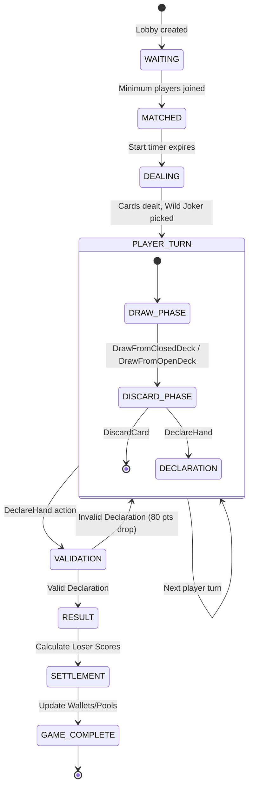

# PART 2: GAME ENGINE, STATE MACHINE, MULTIPLAYER & REPLAY

This document defines the core Game Engine, State Machine, and Multiplayer architecture for the Indian 13-Card Rummy platform. The engine is designed as a pure, deterministic Dart library to guarantee cross-platform consistency (client prediction and server authority) and enable seamless replay functionality.

---

## 1. 13-Card Indian Rummy Rules Engine

The rules engine strictly enforces standard 13-Card Indian Rummy mechanics. It relies on mathematical evaluation of card sets and sequences.

### Core Configuration
- **Decks:** 2 standard decks (52 cards each) + 2 Printed Jokers = 106 cards total. (Scales to 3 decks for 6-player games).
- **Players:** 2 to 6 players per table.
- **Hand Size:** 13 cards dealt to each player.
- **Jokers:**
  - **Printed Joker (PJ):** The standard joker cards included in a deck.
  - **Wild Joker (WJ):** A randomly selected card after dealing. All cards of that rank become Wild Jokers. If a Printed Joker is selected as the Wild Joker, the Ace of Spades (`A♠`) defaults to the Wild Joker.

### Valid Declaration Requirements
A valid 13-card declaration must organize all 13 cards into valid sets and sequences, satisfying the following strict conditions:
1. **Minimum 2 Sequences:** The hand must contain at least two valid sequences.
2. **At least 1 Pure Sequence:** One of the sequences must be purely natural (no jokers).
3. **All cards grouped:** Every card in the hand must belong to a valid group (minimum 3 cards per group, up to a 13-card sequence).

#### Group Types
- **Pure Sequence:** 3 or more consecutive cards of the exact same suit, strictly WITHOUT any jokers (unless the Wild Joker is used in its natural face value/suit).
  - *Example:* `4♥ 5♥ 6♥`
- **Impure Sequence:** 3 or more consecutive cards of the same suit, containing one or more Jokers (Printed or Wild) as substitutes.
  - *Example:* `4♥ 5♥ PJ` or `7♣ 8♣ 2♦(WJ) 10♣`
- **Sets:** 3 or 4 cards of the *same rank* but *different suits*. Jokers can be used to complete a set. A set cannot contain two cards of the same suit.
  - *Example:* `8♥ 8♣ 8♠` or `Q♥ Q♦ PJ`

### Scoring
- **Face Cards (K, Q, J):** 10 points each.
- **Aces (A):** 10 points each.
- **Number Cards (2-10):** Face value (e.g., 5 = 5 points).
- **Jokers (Printed and Wild):** 0 points.
- **Winner:** 0 points.
- **Maximum Penalty:** Capped at 80 points per game for any player.

### Drop Penalties
- **First Drop:** Dropping before drawing the first card (20 points).
- **Middle Drop:** Dropping any time after the first draw (40 points).
- **Full Count:** Invalid declaration or game loss without any valid pure sequence (80 points).
- **Invalid Declaration:** Immediate 80 points penalty, and the game continues for other players if more than one remains.

---

## 2. Game Engine as Pure Library

The Game Engine is constructed as a pure Dart library. It enforces **ZERO** dependencies on Flutter UI, databases, HTTP network layers, or file systems. It is entirely deterministic, meaning identical inputs (initial state + ordered actions) will always yield the exact same resulting state.

### Core Interface Definitions

```dart
abstract class GameEngine {
  /// Initializes a new game state given a specific configuration and seed.
  GameState createGame(GameConfig config, int seed);
  
  /// Processes a player action and returns the new immutable game state.
  GameState processAction(GameState state, GameAction action);
  
  /// Evaluates a declaration and returns detailed validity metrics.
  ValidationResult validateDeclaration(List<List<Card>> groups, Card wildJoker);
  
  /// Calculates the score for an ungrouped list of cards based on rummy rules.
  int calculateScore(List<Card> hand, Card wildJoker);
}

class GameConfig {
  final String gameId;
  final GameMode mode; // POINTS, POOL_101, POOL_201, DEALS
  final int maxPlayers;
  final int turnTimeoutSeconds;
  final int deckCount;
  
  const GameConfig({
    required this.gameId,
    required this.mode,
    required this.maxPlayers,
    this.turnTimeoutSeconds = 30,
    this.deckCount = 2,
  });
}
```

---

## 3. Card & Deck Model

The card model uses integers internally for fast bitwise comparisons but exposes standard enums for readability.

```dart
enum Suit { hearts, diamonds, clubs, spades }
enum Rank { ace, two, three, four, five, six, seven, eight, nine, ten, jack, queen, king }

class Card {
  final Suit? suit;  // null if printed joker
  final Rank? rank;  // null if printed joker
  final int deckIndex; // 0 or 1 (differentiates duplicate cards from multiple decks)
  final bool isPrintedJoker;

  const Card({
    this.suit,
    this.rank,
    required this.deckIndex,
    this.isPrintedJoker = false,
  });

  // Unique integer representation for fast serialization (e.g., 0-105)
  int toInt() {
    if (isPrintedJoker) return 52 + deckIndex;
    return (deckIndex * 52) + (suit!.index * 13) + rank!.index;
  }

  static Card fromInt(int val) {
    if (val == 52 || val == 53) {
      return Card(deckIndex: val - 52, isPrintedJoker: true);
    }
    int deckIndex = val >= 52 ? 1 : 0;
    int normalized = val % 52;
    return Card(
      suit: Suit.values[(normalized / 13).floor()],
      rank: Rank.values[normalized % 13],
      deckIndex: deckIndex,
    );
  }

  bool get isWildJoker => false; // Contextual, evaluated against GameState's wildJoker
}

class Deck {
  final List<Card> cards;
  
  Deck(this.cards);

  /// Initializes multiple decks and shuffles using a deterministic Random seed
  static Deck initialize(int numberOfDecks, int seed) {
    List<Card> initialCards = [];
    for (int d = 0; d < numberOfDecks; d++) {
      for (var suit in Suit.values) {
        for (var rank in Rank.values) {
          initialCards.add(Card(suit: suit, rank: rank, deckIndex: d));
        }
      }
      initialCards.add(Card(deckIndex: d, isPrintedJoker: true)); // 1 PJ per deck
    }
    initialCards.shuffle(Random(seed));
    return Deck(initialCards);
  }
}
```

---

## 4. Game State Machine

The state machine strictly governs the game lifecycle. Actions are only processed if the `GameState` is in a legal state for that action.



### State Definitions:
1. **WAITING:** Table is open, waiting for `maxPlayers` to join.
2. **MATCHED:** Players locked, 5-second countdown to DEALING.
3. **DEALING:** Internal server state; deterministically shuffles, deals 13 cards, opens 1 card to the open deck, and picks 1 Wild Joker.
4. **PLAYER_TURN:** Wait for current player's action. Timer starts.
5. **DRAW_PHASE:** Player MUST pick a card from the closed or open deck.
6. **DISCARD_PHASE:** Player MUST discard one card from their 14 cards, OR place a card on the finish slot to trigger `DECLARATION`.
7. **DECLARATION:** Player submits their grouped 13 cards.
8. **VALIDATION:** Engine evaluates the declaration.
9. **RESULT/SETTLEMENT:** Calculate chips/points to transfer.
10. **GAME_COMPLETE:** Final payouts, cleanup.

---

## 5. Game Actions & Commands

Every state mutation in the game is triggered by a `GameAction`.

```dart
abstract class GameAction {
  final String playerId;
  final String gameId;
  final int sequenceNumber;
  final DateTime timestamp;

  GameAction({
    required this.playerId,
    required this.gameId,
    required this.sequenceNumber,
    required this.timestamp,
  });
}

class DrawFromClosedDeck extends GameAction {
  DrawFromClosedDeck({required super.playerId, required super.gameId, required super.sequenceNumber, required super.timestamp});
}

class DrawFromOpenDeck extends GameAction {
  DrawFromOpenDeck({required super.playerId, required super.gameId, required super.sequenceNumber, required super.timestamp});
}

class DiscardCard extends GameAction {
  final Card card;
  DiscardCard(this.card, {required super.playerId, required super.gameId, required super.sequenceNumber, required super.timestamp});
}

class DeclareHand extends GameAction {
  final List<List<Card>> groups; // Must total 13 cards
  DeclareHand(this.groups, {required super.playerId, required super.gameId, required super.sequenceNumber, required super.timestamp});
}

enum DropType { FIRST_DROP, MIDDLE_DROP }
class DropGame extends GameAction {
  final DropType type;
  DropGame(this.type, {required super.playerId, required super.gameId, required super.sequenceNumber, required super.timestamp});
}

class SendChat extends GameAction {
  final String message;
  SendChat(this.message, {required super.playerId, required super.gameId, required super.sequenceNumber, required super.timestamp});
}

class RequestReconnect extends GameAction {
  final String reconnectToken;
  RequestReconnect(this.reconnectToken, {required super.playerId, required super.gameId, required super.sequenceNumber, required super.timestamp});
}
```

---

## 6. Server-Side Validation

The authoritative server receives an action, injects it into the engine, and evaluates the `ValidationResult`. Every action undergoes strict validation:

1. **Identity & Authentication:** Valid JWT and player identity.
2. **Game Exists & Active:** `gameId` maps to an active session in memory.
3. **Turn Verification:** `playerId` MUST match `GameState.currentPlayerId`.
4. **Phase Validity:** E.g., `DiscardCard` is illegal during `DRAW_PHASE`.
5. **Card Ownership:** During `DiscardCard` or `DeclareHand`, the server verifies the player's internal server-side hand array actually contains the exact cards they claim to have.
6. **Sequence Alignment:** `sequenceNumber` strictly incremental to prevent replay attacks and out-of-order execution over unstable websockets.
7. **Timeout Limits:** Actions received after the server-side turn timer expires are rejected (server forces auto-draw/discard or drop).
8. **Rate Limiting:** Throttle excessive non-state actions (like Emotes/Chat).

---

## 7. Declaration Validation Algorithm

Validating 13 cards is the most critical logic block in the Rummy engine.

```dart
class ValidationResult {
  final bool isValid;
  final int penaltyScore;
  final String? errorMessage;
  
  ValidationResult(this.isValid, this.penaltyScore, {this.errorMessage});
}

class DeclarationValidator {
  ValidationResult validate(List<List<Card>> groups, Card wildJoker) {
    int totalCards = 0;
    int pureSequenceCount = 0;
    int totalSequenceCount = 0;
    
    // 1. Verify exactly 13 cards
    for (var group in groups) {
      totalCards += group.length;
    }
    if (totalCards != 13) return ValidationResult(false, 80, errorMessage: 'Invalid card count');

    // 2. Classify each group
    for (var group in groups) {
      if (group.length < 3) return ValidationResult(false, 80, errorMessage: 'Group has fewer than 3 cards');

      if (_isPureSequence(group, wildJoker)) {
        pureSequenceCount++;
        totalSequenceCount++;
      } else if (_isImpureSequence(group, wildJoker)) {
        totalSequenceCount++;
      } else if (_isSet(group, wildJoker)) {
        // Valid set, no sequence count increment
      } else {
        return ValidationResult(false, 80, errorMessage: 'Invalid group detected');
      }
    }

    // 3. Final Rule Checks
    if (pureSequenceCount < 1) {
      return ValidationResult(false, 80, errorMessage: 'Missing Pure Sequence');
    }
    if (totalSequenceCount < 2) {
      return ValidationResult(false, 80, errorMessage: 'Need at least 2 sequences');
    }

    return ValidationResult(true, 0); // Valid Declaration
  }

  bool _isPureSequence(List<Card> group, Card wildJoker) {
    // Must have same suit, sequential ranks, NO jokers 
    // (Except wild joker used as its natural rank/suit).
    if (group.any((c) => c.isPrintedJoker)) return false;
    
    Suit? groupSuit = group.first.suit;
    if (group.any((c) => c.suit != groupSuit)) return false;

    List<int> ranks = group.map((c) => c.rank!.index).toList()..sort();
    
    // Check consecutive logic (handling A-2-3 and Q-K-A)
    return _checkConsecutive(ranks);
  }

  bool _isImpureSequence(List<Card> group, Card wildJoker) {
    // Like pure, but allows Joker substitutions.
    // Ensure all non-joker cards share the same suit and can form a sequence with gaps filled by jokers.
    // ... [Implementation details omitted for brevity, involves gap analysis]
    return true; 
  }

  bool _isSet(List<Card> group, Card wildJoker) {
    if (group.length > 4) return false;
    // Extract non-joker cards
    var naturalCards = group.where((c) => !c.isPrintedJoker && c.rank != wildJoker.rank).toList();
    if (naturalCards.isEmpty) return true; // All jokers is technically a valid set
    
    Rank targetRank = naturalCards.first.rank!;
    Set<Suit> seenSuits = {};
    
    for (var c in naturalCards) {
      if (c.rank != targetRank) return false;
      if (seenSuits.contains(c.suit)) return false; // Two cards of same suit not allowed in Set
      seenSuits.add(c.suit!);
    }
    return true;
  }
}
```

---

## 8. Scoring System

If a player successfully declares, the other players are penalized based on their hand.

1. **Check for Pure Sequence:** If a loser has NO pure sequence, all 13 cards are summed.
2. **Check for 2nd Sequence:** If a loser has a pure sequence but NO second sequence, all cards EXCEPT the pure sequence are summed.
3. **Valid Groups Excluded:** If a loser has a pure sequence AND a second sequence, only ungrouped (invalid) cards are summed.
4. **Value calculation:**
   - A, K, Q, J = 10 pts.
   - Jokers = 0 pts.
   - 2-10 = Face Value.
5. **Cap:** Maximum score for a loser is 80.

---

## 9. Deterministic Replay System

To combat fraud, resolve disputes, and allow players to share games, every match is recorded via a Replay Model. Because the engine is deterministic, we only need the initial state and the event stream.

### Data Format

```dart
class GameReplay {
  final String gameId;
  final int randomSeed; // Critical for regenerating the deck
  final Card wildJoker;
  final List<String> playerIds;
  final List<ReplayEvent> events;
  final DateTime startTime;
  
  // Stored in S3 as compressed JSON/Protobuf
  Map<String, dynamic> toJson() { ... }
}

class ReplayEvent {
  final int sequenceNumber;
  final String playerId;
  final GameAction action; // Polymorphic action (e.g. Draw, Discard)
  final int delayMilliseconds; // Time since last event, for playback timing
}
```

### Storage and Playback
- **Storage:** Upon `GAME_COMPLETE`, the server serializes the `GameReplay` to JSON, compresses it via GZIP, and uploads it to AWS S3. The DB only stores the S3 URI.
- **Playback:** The Flutter client downloads the JSON file. It initializes the `GameEngine` with the exact `randomSeed`, reproducing the initial deal. It then feeds the `events` array into `engine.processAction()` on a timer corresponding to `delayMilliseconds`.

---

## 10. Multiplayer Architecture

We utilize an **Authoritative Server Architecture** with WebSockets (`dart:io` Server or Node.js Socket.io).

- **Client prediction is NOT used for state:** Because cards are hidden, the client cannot predict the state of the deck. Every action must round-trip to the server.
- **Protocol:** JSON over WebSocket.
  - `Client -> Server`: `{ "event": "ACTION", "payload": { "type": "DiscardCard", "card": 42 }, "seq": 5 }`
  - `Server -> Client`: `{ "event": "STATE_UPDATE", "payload": { "activePlayer": "p2", "openDeckTop": 42 }, "seq": 5 }`

### Connection Lifecycle
1. **Connect:** TCP WebSocket connection established.
2. **Authenticate:** Client sends `AUTH { jwt }`. Server maps Socket ID to User ID.
3. **Join Game:** Client sends `JOIN { gameId }`. Server adds to the room broadcast list.
4. **State Sync:** Server sends full current `GameStateView` (scrubbed of opponent hidden cards).
5. **Heartbeat:** Ping/Pong every 5 seconds to detect dead connections.

---

## 11. Disconnect & Timeout Handling

Handling mobile network drops is a critical feature in Indian gaming.

- **Timeout Detection:** 3 missed heartbeats (15s) flags the player as `DISCONNECTED`.
- **Grace Period:** The server provides a **60-second grace period** for reconnection before penalizing.
- **Auto-Play:** If it is a disconnected player's turn, the server waits the standard turn time (e.g., 30s). When the timer expires, the server injects an `AutoDraw` (from closed deck) and `AutoDiscard` (the same drawn card) action.
- **Auto-Drop:** If a player misses 3 consecutive turns via timeout, the server forcefully injects a `DropGame(MIDDLE_DROP)` action and permanently kicks the player.
- **Reconnection:** Client connects with `{ "event": "RECONNECT", "token": "xyz" }`. Server validates, updates the socket mapping, and sends a fresh `GameStateView`.

---

## 12. Game Modes as Plugins

Different rummy variants share the engine but override specific lifecycle rules (like when the match ends and how chips are settled).

```dart
abstract class GameModePlugin {
  GameConfig get config;
  
  /// In Points rummy, score * pointValue. In Pool, just score.
  double calculatePayout(int score, double pointValue);
  
  /// In Pool rummy, this checks if player score > 101/201.
  bool isGameOver(Map<String, int> totalScores);
  
  /// Settlement logic
  void processSettlement(GameState state);
}

class PointsRummyPlugin extends GameModePlugin {
  @override
  double calculatePayout(int score, double pointValue) => score * pointValue;
  
  @override
  bool isGameOver(Map<String, int> totalScores) => true; // Single deal
}

class Pool101RummyPlugin extends GameModePlugin {
  @override
  bool isGameOver(Map<String, int> totalScores) {
    int activePlayers = totalScores.values.where((s) => s < 101).length;
    return activePlayers <= 1;
  }
}
```

---

## 13. Spectator System Architecture

Spectating enables social sharing, streaming, and customer support visibility.

- **Data Privacy:** Spectators connect to a separate WebSocket channel (`room:gameId:spectator`). The state updates broadcast to this channel NEVER contain the private hands of the active players, preventing screen-cheating.
- **AI/Admin View:** Admin dashboards or support staff with elevated JWT roles can subscribe to a secure `room:gameId:admin` channel which *does* transmit hidden cards for dispute resolution.
- **Delay:** For high-stakes tournament modes, spectator feeds are buffered and delayed by 180 seconds on the server before broadcasting.
- **Opt-out:** Private tables can set a `allowSpectators: false` flag in the `GameConfig`.

--- 
*End of Part 2 Master Specification.*
