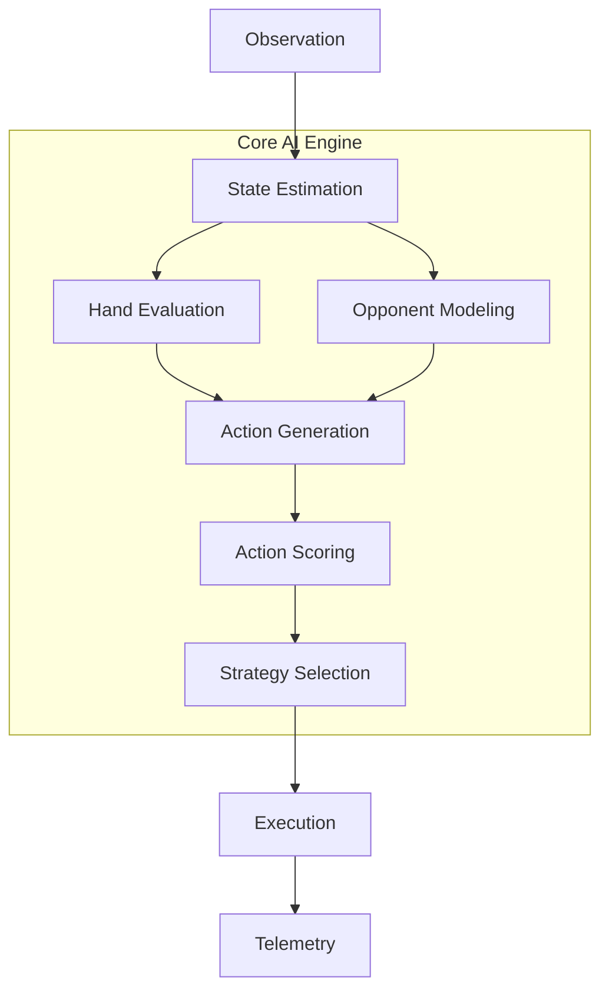
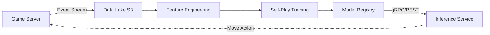

# PART 3: AI OPPONENT SYSTEM

This section details the artificial intelligence system for the Indian 13-Card Rummy platform. The AI serves multiple roles: providing opponents for single-player practice, filling empty seats in multiplayer lobbies (if configured), and acting as a drop-in replacement when human players disconnect.

## 1. AI Architecture Overview

The AI engine operates as a deterministic, heuristic-driven pipeline in V1, designed to evaluate game state, model opponent behavior, and select actions that maximize the probability of winning while adhering to human-like play patterns.

### The AI Pipeline



### Layer Definitions & Dart Interfaces

Each layer in the pipeline is strictly defined by Dart interfaces to ensure modularity and ease of testing.

```dart
/// The main entry point for the AI Engine.
abstract class AIEngine {
  /// Processes the visible game state and returns a game action.
  GameAction calculateNextMove(AIObservation observation, AIConfig config);
  
  /// Called when an opponent makes a move, to update internal models.
  void recordOpponentAction(OpponentAction action);
}

/// Defines the output action of the AI.
class GameAction {
  final DrawDecision drawDecision;
  final Card discardCard;
  final bool declare;
  final List<CardGroup>? declareGroups;
  
  GameAction({
    required this.drawDecision,
    required this.discardCard,
    this.declare = false,
    this.declareGroups,
  });
}
```

## 2. AI as a Pure Dart Library

To maximize reusability and strictly enforce security, the AI system is built as a pure, isolated Dart package: `packages/ai-engine/`.

- **Dependencies:** It depends *only* on `packages/game-engine/` (which contains card models, rules, and fundamental Rummy logic). It has no external network or UI dependencies.
- **Execution Environment:** It can run in an Isolate on the Flutter client (for offline practice) or as a standalone Dart process/Isolate on the Node.js/Dart backend (for server-side bots).
- **Security Guarantee:** The AI is inherently stateless regarding hidden information. It accepts an `AIObservation` object containing *only* the data a human player would see. It explicitly **cannot** access the server's master deck state or other players' hidden hands, preventing "cheating" and ensuring fair play.

## 3. AI Observation Layer

The observation layer acts as the sensory input for the AI. It encapsulates everything the AI is allowed to know at the exact moment it needs to make a decision.

```dart
/// Represents the perfectly observable state of the game from the AI's perspective.
class AIObservation {
  /// The AI's current hand (typically 13 cards, or 14 if a draw just occurred).
  final List<Card> hand;              
  
  /// The visible discard pile, ordered from oldest to newest.
  final List<Card> discardPile;       
  
  /// The designated wild joker for this round.
  final Card wildJoker;
  
  /// Number of cards left in the closed deck (useful for endgame strategy).
  final int closedDeckRemaining;
  
  /// The current turn number of the game.
  final int turnNumber;
  
  /// Public information about opponents (e.g., number of cards held, score).
  final Map<String, PlayerPublicInfo> opponents;
  
  /// Cards that are logically impossible to draw (e.g., in hand, in discard pile).
  final List<Card> knownDeadCards;    
  
  AIObservation({
    required this.hand,
    required this.discardPile,
    required this.wildJoker,
    required this.closedDeckRemaining,
    required this.turnNumber,
    required this.opponents,
    required this.knownDeadCards,
  });
  
  /// Convenience getter for the top of the discard pile.
  Card? get topOfOpenPile => discardPile.isNotEmpty ? discardPile.last : null;
}

class PlayerPublicInfo {
  final String playerId;
  final int cardsInHand; // Always 13, unless they've drawn and not discarded.
  final bool hasDropped;
  
  PlayerPublicInfo({
    required this.playerId,
    required this.cardsInHand,
    required this.hasDropped,
  });
}
```

## 4. Hand Evaluation Engine

The Hand Evaluation Engine is the computational core of the AI. Given a 13-card or 14-card hand, it must find the optimal partitioning of cards into melds (sequences and sets) that minimizes the total deadwood points. 

Because a 13-card hand has a manageable state space, we use a recursive backtracking algorithm with memoization to evaluate all valid grouping combinations.

### Complete Evaluation Algorithm

```dart
class HandEvaluator {
  final RulesConfig rules;

  HandEvaluator({required this.rules});

  /// Evaluates the hand and returns the optimal scoring partition.
  HandScore evaluate(List<Card> hand, Card wildJoker) {
    // 1. Generate all possible pure sequences
    List<CardGroup> pureSequences = _findPureSequences(hand);
    
    // 2. Generate all possible impure sequences (using jokers)
    List<CardGroup> impureSequences = _findImpureSequences(hand, wildJoker);
    
    // 3. Generate all possible sets (using jokers if needed)
    List<CardGroup> sets = _findSets(hand, wildJoker);
    
    // Combine all valid melds
    List<CardGroup> allPossibleMelds = [...pureSequences, ...impureSequences, ...sets];
    
    // 4. Find the optimal grouping minimizing deadwood (recursive search)
    HandScore optimalScore = _findOptimalPartition(hand, allPossibleMelds, wildJoker);
    
    // 5. Analyze needed and disposable cards based on optimal grouping
    optimalScore = _enrichWithStrategyData(optimalScore, hand, wildJoker);
    
    return optimalScore;
  }

  /// Recursive backtracking to find the combination of non-overlapping melds
  /// that results in the minimum deadwood points.
  HandScore _findOptimalPartition(List<Card> hand, List<CardGroup> allMelds, Card joker) {
    HandScore bestScore = HandScore.worstPossible(hand);
    
    // Base case: No melds, all cards are deadwood
    int baseDeadwood = _calculateDeadwood(hand, [], joker);
    bestScore = HandScore(
      deadwoodPoints: baseDeadwood,
      groups: [],
      ungrouped: List.from(hand),
      canDeclare: false,
    );

    // Try each meld as a starting point
    for (int i = 0; i < allMelds.length; i++) {
      CardGroup meld = allMelds[i];
      if (_canForm(hand, meld)) {
        // Remove meld cards from hand
        List<Card> remainingHand = _removeCards(hand, meld.cards);
        
        // Recursively find optimal partition for remaining cards
        // Optimization: Pass only melds from index i onward to avoid duplicate subset evaluation
        HandScore subScore = _findOptimalPartition(remainingHand, allMelds.sublist(i), joker);
        
        // Combine current meld with sub-score
        List<CardGroup> currentGroups = [meld, ...subScore.groups];
        int currentDeadwood = _calculateDeadwood(hand, currentGroups, joker);
        
        if (currentDeadwood < bestScore.deadwoodPoints) {
          bestScore = HandScore(
            deadwoodPoints: currentDeadwood,
            groups: currentGroups,
            ungrouped: _getUngrouped(hand, currentGroups),
            canDeclare: _isValidDeclaration(currentGroups, remainingHand.isEmpty),
          );
        }
      }
    }
    
    return bestScore;
  }

  int _calculateDeadwood(List<Card> originalHand, List<CardGroup> groups, Card wildJoker) {
    bool hasPureSequence = groups.any((g) => g.type == GroupType.pureSequence);
    bool hasTwoSequences = groups.where((g) => g.type == GroupType.pureSequence || g.type == GroupType.impureSequence).length >= 2;
    
    // Rummy rules: If no pure sequence, all cards are deadwood
    if (!hasPureSequence) return _sumCardPoints(originalHand, wildJoker);
    
    // If one pure sequence but not a second sequence, everything outside the pure sequence is deadwood
    if (!hasTwoSequences) {
      List<Card> pureCards = groups.firstWhere((g) => g.type == GroupType.pureSequence).cards;
      List<Card> deadwood = _removeCards(originalHand, pureCards);
      return _sumCardPoints(deadwood, wildJoker);
    }
    
    // Otherwise, deadwood is just the ungrouped cards
    List<Card> ungrouped = _getUngrouped(originalHand, groups);
    return _sumCardPoints(ungrouped, wildJoker);
  }

  // ... Helper methods (_findPureSequences, _canForm, etc.) omitted for brevity
}
```

### HandScore Data Structure

```dart
class HandScore {
  final int deadwoodPoints;
  final List<CardGroup> groups;
  final List<Card> ungrouped;
  final bool canDeclare;
  
  // Strategy Enriched Fields
  double completionPercentage = 0.0;
  List<Card> neededCards = [];
  List<Card> disposableCards = [];

  HandScore({
    required this.deadwoodPoints,
    required this.groups,
    required this.ungrouped,
    required this.canDeclare,
  });

  factory HandScore.worstPossible(List<Card> hand) {
    return HandScore(
      deadwoodPoints: 80, // Max Rummy score
      groups: [],
      ungrouped: hand,
      canDeclare: false,
    );
  }
}

class CardGroup {
  final List<Card> cards;
  final GroupType type; // pureSequence, impureSequence, set
  
  CardGroup(this.cards, this.type);
}
```

## 5. Card Tracking & Probability

To make informed decisions, the AI must track the probability of drawing specific cards. This separates intermediate AI (which plays only based on its own hand) from advanced AI (which calculates risks).

```dart
class CardTracker {
  final Set<Card> seenCards = {};
  final Map<Card, int> discardCounts = {};
  final int totalDecks = 2; // Standard 13-card rummy uses 2 decks (104 cards + Jokers)
  
  void recordVisibleCard(Card card) {
    seenCards.add(card);
    discardCounts[card] = (discardCounts[card] ?? 0) + 1;
  }

  /// Calculates the exact probability of drawing a specific card from the closed deck.
  double probabilityOfDrawing(Card card, AIObservation obs) {
    int totalUnseen = (totalDecks * 54) - seenCards.length - obs.hand.length; // 54 includes printed jokers
    
    int copiesTotal = (card.isPrintedJoker) ? totalDecks * 2 : totalDecks; // 2 of each rank/suit, 4 printed jokers
    int copiesSeen = discardCounts[card] ?? 0;
    
    // Check if we hold copies in our hand
    int copiesInHand = obs.hand.where((c) => c == card).length;
    
    int copiesRemaining = copiesTotal - copiesSeen - copiesInHand;
    
    if (copiesRemaining <= 0 || totalUnseen <= 0) return 0.0;
    return copiesRemaining / totalUnseen;
  }
  
  /// Returns the probability of completing a meld given a list of needed cards.
  double probabilityOfCompletingMeld(List<Card> neededCards, AIObservation obs) {
    // Uses inclusion-exclusion principle for probabilities of independent target cards
    double noDrawProb = 1.0;
    for (var card in neededCards) {
      double p = probabilityOfDrawing(card, obs);
      noDrawProb *= (1.0 - p);
    }
    return 1.0 - noDrawProb;
  }
}
```

## 6. Opponent Modeling

Advanced AI uses inference to guess what opponents are trying to build. When an opponent picks a card from the open pile, they broadcast their intentions.

### Inference Rules
1. **The Sequence Rule:** If an opponent picks `7♥`, they likely hold `6♥` & `8♥`, or `5♥` & `6♥`, or `8♥` & `9♥`.
2. **The Set Rule:** If an opponent picks `7♥`, they might hold `7♠` & `7♦`.
3. **The Discard Rule:** If an opponent discards `K♣`, they are highly unlikely to be building a sequence around `K♣` (so `Q♣` and `A♣` are slightly safer to discard).

```dart
class OpponentModel {
  final String opponentId;
  
  // Cards the opponent has picked from the open pile
  final List<Card> pickedCards = [];
  
  // Cards the opponent has discarded
  final List<Card> discardedCards = [];
  
  // Heatmap of dangerous suits and ranks (0.0 to 1.0)
  final Map<Suit, double> suitDanger = {Suit.hearts: 0, Suit.diamonds: 0, Suit.clubs: 0, Suit.spades: 0};
  final Map<Rank, double> rankDanger = {};

  OpponentModel(this.opponentId);

  void recordOpponentPick(Card card) {
    pickedCards.add(card);
    
    // Increase danger for this exact rank across other suits (Set inference)
    rankDanger[card.rank] = 1.0;
    
    // Increase danger for adjacent ranks in the same suit (Sequence inference)
    suitDanger[card.suit] = (suitDanger[card.suit] ?? 0) + 0.3;
  }

  void recordOpponentDiscard(Card card) {
    discardedCards.add(card);
    // Discarding a card makes its immediate neighbors slightly less dangerous
  }

  /// Calculates how dangerous it is to discard a specific card to this opponent.
  double getDiscardDangerRating(Card card) {
    if (pickedCards.isEmpty) return 0.1; // Default low risk
    
    double risk = 0.0;
    
    // 1. Direct Set Risk
    if (rankDanger[card.rank] != null && rankDanger[card.rank]! > 0.5) {
      risk += 0.6;
    }
    
    // 2. Adjacent Sequence Risk
    for (Card picked in pickedCards) {
      if (picked.suit == card.suit) {
        int distance = (picked.rank.index - card.rank.index).abs();
        if (distance == 1) risk += 0.7; // Very high risk (e.g., they picked 7, we discard 8)
        if (distance == 2) risk += 0.4; // High risk (they picked 7, we discard 9)
      }
    }
    
    return risk.clamp(0.0, 1.0);
  }
}
```

## 7. Strategy Engine

The AI doesn't play with a single static policy. It dynamically shifts between four core strategies based on the game state.

### Strategy Definitions
*   **Strategy A: Sequence-First (Default)** - Prioritizes building a pure sequence at all costs. Ignores sets.
*   **Strategy B: Set-Priority** - Triggered when pure sequence is secured, but sequence cards are scarce. Maximizes use of duplicate ranks.
*   **Strategy C: Defensive** - Triggered when an opponent is likely to declare and our deadwood is high (>40). Prioritizes dropping high-value cards over completing melds.
*   **Strategy D: Aggressive** - Triggered when completion is >80%. Takes higher risks, draws from open pile even if it reveals information, pushes for immediate declaration.

### Strategy Switching Logic

```dart
enum Strategy { sequenceFirst, setPriority, defensive, aggressive, declare }

class StrategySelector {
  Strategy selectStrategy(AIObservation obs, HandScore score, Map<String, OpponentModel> opponents) {
    // 1. Always declare if possible
    if (score.canDeclare) return Strategy.declare;
    
    // 2. Defensive check: Is anyone about to win?
    bool anyOpponentClose = opponents.values.any((model) => model.pickedCards.length >= 3);
    if (anyOpponentClose && score.deadwoodPoints > 40) {
      return Strategy.defensive;
    }
    
    // 3. Aggressive check: Are we close to winning?
    bool hasPureAndImpure = score.groups.where((g) => g.type == GroupType.pureSequence).isNotEmpty &&
                            score.groups.where((g) => g.type == GroupType.impureSequence).isNotEmpty;
    if (hasPureAndImpure && score.deadwoodPoints <= 15) {
      return Strategy.aggressive;
    }
    
    // 4. Fallbacks based on turn and melds
    bool hasPureSequence = score.groups.any((g) => g.type == GroupType.pureSequence);
    if (obs.turnNumber > 6 && hasPureSequence) {
      return Strategy.setPriority;
    }
    
    return Strategy.sequenceFirst;
  }
}
```

## 8. Decision Making: Draw

The Draw decision determines whether to pick from the closed deck or the open discard pile. Picking from the open pile is deterministic (we know the card), but it reveals information to opponents.

```dart
DrawDecision decideDrawSource(
    AIObservation obs, HandScore currentScore, Strategy strategy, OpponentModel nextOpponent) {
  
  Card? topOfOpenPile = obs.topOfOpenPile;
  if (topOfOpenPile == null) return DrawDecision.closedDeck;

  // Evaluate the hypothetical hand if we pick the open card
  // (We assume we will discard our current worst ungrouped card)
  Card worstCard = _findWorstCard(currentScore.ungrouped, obs.wildJoker);
  List<Card> hypotheticalHand = List.from(obs.hand)
    ..remove(worstCard)
    ..add(topOfOpenPile);
    
  HandScore newScore = handEvaluator.evaluate(hypotheticalHand, obs.wildJoker);
  
  // Calculate raw deadwood improvement
  int improvement = currentScore.deadwoodPoints - newScore.deadwoodPoints;
  
  // Strategy-specific thresholds
  int requiredImprovement = 0;
  switch (strategy) {
    case Strategy.sequenceFirst:
      // Only pick if it helps form a sequence
      requiredImprovement = 10; 
      break;
    case Strategy.aggressive:
      // Pick if it helps at all
      requiredImprovement = 2;
      break;
    case Strategy.defensive:
      // Rarely pick from open, minimizes revealing info
      requiredImprovement = 20;
      break;
    default:
      requiredImprovement = 10;
  }

  // Risk calculation: Does picking this tell the next opponent what we need?
  // (Less critical in 2-player, highly critical in 6-player)
  
  if (improvement >= requiredImprovement) {
    // Special rule: Never pick a joker from the open pile unless it's a printed joker
    // and house rules allow it (standard Indian Rummy usually forbids picking discarded jokers).
    if (topOfOpenPile.isWild(obs.wildJoker)) {
       return DrawDecision.closedDeck;
    }
    return DrawDecision.openPile;
  }
  
  return DrawDecision.closedDeck;
}
```

## 9. Decision Making: Discard

Discarding is the most critical AI decision. A bad discard hands the game to the opponent.

```dart
Card decideDiscard(
    AIObservation obs, HandScore currentScore, Strategy strategy, OpponentModel nextOpponent) {
  
  List<Card> candidates = currentScore.ungrouped;
  
  // If somehow all cards are grouped (14 cards total), we have to break a meld.
  if (candidates.isEmpty) {
    candidates = _findLeastValuableMeldCards(currentScore);
  }

  Card bestDiscard = candidates.first;
  double highestScore = -999.0;

  for (Card card in candidates) {
    double score = 0.0;
    
    // 1. Reward discarding high-value deadwood (reduces point liability)
    score += card.pointValue * 0.5; 
    
    // 2. Penalize discarding cards that might form melds for us
    double potentialMeldProb = cardTracker.probabilityOfCompletingMeld([/* cards adjacent to this */], obs);
    score -= (potentialMeldProb * 50);

    // 3. Penalty for discarding dangerous cards to the next opponent
    double opponentDanger = nextOpponent.getDiscardDangerRating(card);
    if (strategy == Strategy.defensive) {
      score -= (opponentDanger * 100); // Massive penalty in defensive mode
    } else {
      score -= (opponentDanger * 30);
    }
    
    // 4. Bonus for discarding "safe" cards (already discarded previously)
    if (obs.discardPile.any((c) => c.rank == card.rank && c.suit == card.suit)) {
      score += 20.0; // Known safe card
    }

    if (score > highestScore) {
      highestScore = score;
      bestDiscard = card;
    }
  }

  return bestDiscard;
}
```

## 10. AI Difficulty Levels

The game supports four distinct AI difficulty levels, controlled via the `AIConfig` class. This allows the AI to simulate different echelons of human players.

```dart
enum AILevel { beginner, intermediate, advanced, expert }

class AIConfig {
  final AILevel level;
  
  /// Probability (0.0 to 1.0) of making a mathematically suboptimal discard
  final double mistakeRate;        
  
  /// Number of Monte Carlo rollouts to perform (0 disables MCTS)
  final int monteCarloRollouts;    
  
  /// Whether the AI tracks opponent pick/discard history to infer hands
  final bool useOpponentModel;
  
  /// Whether the AI calculates draw probabilities from the closed deck
  final bool useProbability;
  
  /// Whether the AI dynamically switches strategies (A/B/C/D)
  final bool useStrategySwitching;
  
  /// Artificial delay to simulate human thinking, preventing immediate instantaneous moves
  final Duration thinkingDelay;

  const AIConfig({
    required this.level,
    required this.mistakeRate,
    required this.monteCarloRollouts,
    required this.useOpponentModel,
    required this.useProbability,
    required this.useStrategySwitching,
    required this.thinkingDelay,
  });

  factory AIConfig.beginner() => AIConfig(
    level: AILevel.beginner,
    mistakeRate: 0.25,
    monteCarloRollouts: 0,
    useOpponentModel: false,
    useProbability: false,
    useStrategySwitching: false,
    thinkingDelay: Duration(milliseconds: 1500),
  );

  factory AIConfig.intermediate() => AIConfig(
    level: AILevel.intermediate,
    mistakeRate: 0.10,
    monteCarloRollouts: 0,
    useOpponentModel: true, // Basic tracking
    useProbability: false,
    useStrategySwitching: true,
    thinkingDelay: Duration(milliseconds: 2500),
  );

  factory AIConfig.advanced() => AIConfig(
    level: AILevel.advanced,
    mistakeRate: 0.02,
    monteCarloRollouts: 100,
    useOpponentModel: true,
    useProbability: true,
    useStrategySwitching: true,
    thinkingDelay: Duration(milliseconds: 3500),
  );

  factory AIConfig.expert() => AIConfig(
    level: AILevel.expert,
    mistakeRate: 0.0,
    monteCarloRollouts: 1000,
    useOpponentModel: true,
    useProbability: true,
    useStrategySwitching: true,
    thinkingDelay: Duration(milliseconds: 4500),
  );
}
```

## 11. Monte Carlo Simulation

For the `advanced` and `expert` AI levels, heuristic evaluation is augmented with Monte Carlo Tree Search (MCTS). Because Indian Rummy features hidden information (the closed deck and opponent hands), we use Determinized Monte Carlo (also known as Perfect Information Monte Carlo).

### Simulation Pipeline

1. **Determinization:** The AI creates a hypothetical "flattened" game state by randomly dealing the unknown cards (deck + unseen discard + opponent hands) to opponents and the deck, respecting the known `AIObservation` constraints.
2. **Rollout:** The AI plays out the hand to completion using lightweight policies (e.g., intermediate heuristic AI).
3. **Scoring:** The end state is scored based on Win/Loss and points lost.
4. **Aggregation:** This is repeated `N` times (`monteCarloRollouts`). The action with the highest expected value across all simulations is selected.

```dart
class MonteCarloSimulator {
  final HandEvaluator evaluator;
  
  MonteCarloSimulator(this.evaluator);

  /// Evaluates a proposed discard action by simulating future game states.
  double evaluateAction(GameAction action, AIObservation obs, int rollouts) {
    double totalScore = 0;
    
    for (int i = 0; i < rollouts; i++) {
      // 1. Create hypothetical game state
      GameState simState = _createDeterminizedState(obs);
      
      // Apply the proposed action
      simState.applyAction(action);
      
      // 2. Simulate game forward with simple policies until terminal state or max depth
      int depth = 0;
      while (!simState.isGameOver && depth < 20) { // Max 20 turns ahead
        GameAction randomSimAction = _getFastHeuristicAction(simState);
        simState.applyAction(randomSimAction);
        depth++;
      }
      
      // 3. Score outcome
      totalScore += _scoreTerminalState(simState, obs.myPlayerId);
    }
    
    return totalScore / rollouts;
  }
  
  double _scoreTerminalState(GameState state, String myPlayerId) {
    if (state.winnerId == myPlayerId) return 100.0; // Win is highly rewarded
    
    // If we lose, penalize based on our deadwood points
    int myPoints = evaluator.evaluate(state.getHand(myPlayerId), state.wildJoker).deadwoodPoints;
    return -1.0 * myPoints; // E.g., losing with 80 points = -80.0
  }
}
```

## 12. AI Training Pipeline (Future Roadmaps)

While V1 utilizes the deterministic heuristic and Monte Carlo simulation outlined above, the architecture is designed to support progressive machine learning integration.



### Evolutionary Roadmap
*   **V1: Rule-based Heuristic AI (Launch)** - Deterministic Dart logic. Extremely fast, requires zero external infrastructure. Capable of intermediate/advanced human play.
*   **V2: Probability-enhanced AI (Month 3-4)** - Tuning of heuristic weights based on aggregate player data (tuning `AIConfig` thresholds).
*   **V3: Monte Carlo AI (Month 6-8)** - Activation of the MCTS engine on backend servers for High-Roller bot tables. Requires scaling backend Dart isolates.
*   **V4: Self-Play AI (Month 9-12)** - Generating millions of games using V3 bots against each other. Data is fed into an offline Reinforcement Learning pipeline (e.g., Proximal Policy Optimization).
*   **V5: RL-Trained AI (Year 2)** - A neural network policy replaces the heuristic HandEvaluator. Inference is handled via a dedicated Python microservice, while Dart continues to manage the game state loop.

## 13. AI Performance Telemetry

To ensure the AI is behaving as expected and providing a fun challenge without feeling "cheaty," strict telemetry must be gathered on all AI instances running on the server.

### Key Metrics Tracked (via Mixpanel / Custom Backend Events):

1.  **AI Win Rate by Difficulty Level:**
    *   *Target Beginner:* 20-30% win rate against average humans.
    *   *Target Intermediate:* 45-50% win rate.
    *   *Target Advanced:* 60-65% win rate.
    *   *Target Expert:* 75%+ win rate.
2.  **Average Decision Time:** Must remain under 50ms processing time (excluding artificial delay) to prevent backend CPU bottlenecking.
3.  **Strategy Distribution:** Percentage of time the AI spends in Strategy A vs B vs C vs D. (If Strategy C Defensive is triggered >50% of the time, the risk thresholds are too sensitive).
4.  **Drop Rate:** How often the AI chooses to drop on the first turn vs playing out the hand.
5.  **Player Satisfaction:** Measured by analyzing "Rematch" rates against bots versus humans. If humans leave tables with bots at a >20% higher rate than human-only tables, the AI's playstyle needs tuning (likely perceived as too aggressive or lucky).

*End of Part 3*
